# ha-climate-air-card

[](https://www.home-assistant.io/integrations/marketplace/)
[](https://github.com/juju35/ha-climate-air-card/actions/workflows/hacs.yml)
[](https://github.com/juju35/ha-climate-air-card/actions/workflows/validate.yml)
[](https://github.com/juju35/ha-climate-air-card/actions/workflows/lint.yml)
[](https://github.com/juju35/ha-climate-air-card/releases/latest)
[](https://github.com/juju35/ha-climate-air-card/blob/main/LICENSE)
[](https://buymeacoffee.com/julienstep9)

Lovelace cards for Home Assistant's **air purifiers, fans, air conditioners and thermostats**: one card per kind of device, each with a mini card, and an overview of every device of the instance. Add a card, it finds the device and its sensors by itself. The illustrations come alive while a device runs.

[](https://my.home-assistant.io/redirect/marketplace_repository/?owner=juju35&repository=ha-climate-air-card&category=plugin)

| Card | Type | What it shows |
|---|---|---|
| [Overview](#overview) | `custom:climate-air-overview-card` | Every air conditioner, thermostat, air purifier and fan at a glance: one tile per device, tap a tile to unfold its full card. |
| [Air purifier](#air-purifier) | `custom:climate-air-purifier-card` | Air quality, filter life, presets, speed and options of an air purifier. |
| [Air purifier mini](#mini-cards) | `custom:climate-air-purifier-mini-card` | The same purifier on two lines, with a zoom to the full card. |
| [Fan](#fan) | `custom:climate-air-fan-card` | Speed, oscillation, presets, angle, timer and options of a fan. |
| [Fan mini](#mini-cards) | `custom:climate-air-fan-mini-card` | The same fan on two lines, with a zoom to the full card. |
| [Air conditioner](#air-conditioner) | `custom:climate-air-aircon-card` | Mode, target temperature, fan and swing, measurements and options of an air conditioner. |
| [Air conditioner mini](#mini-cards) | `custom:climate-air-aircon-mini-card` | The same air conditioner on two lines, with a zoom to the full card. |
| [Thermostat](#thermostat) | `custom:climate-air-thermostat-card` | Target temperature, presets, mode, valve, open window and battery of a thermostat, a radiator or a radiator valve. |
| [Thermostat mini](#mini-cards) | `custom:climate-air-thermostat-mini-card` | The same thermostat on two lines, with a zoom to the full card. |

| Overview | Air purifier | Fan | Air conditioner | Thermostat |
|---|---|---|---|---|
| <picture><source media="(prefers-color-scheme: dark)" srcset="https://raw.githubusercontent.com/juju35/ha-climate-air-card/main/screenshots/overview-all-dark.png"></picture> | <picture><source media="(prefers-color-scheme: dark)" srcset="https://raw.githubusercontent.com/juju35/ha-climate-air-card/main/screenshots/purifier-card-dark.png"></picture> | <picture><source media="(prefers-color-scheme: dark)" srcset="https://raw.githubusercontent.com/juju35/ha-climate-air-card/main/screenshots/fan-card-dark.png"></picture> | <picture><source media="(prefers-color-scheme: dark)" srcset="https://raw.githubusercontent.com/juju35/ha-climate-air-card/main/screenshots/aircon-card-dark.png"></picture> | <picture><source media="(prefers-color-scheme: dark)" srcset="https://raw.githubusercontent.com/juju35/ha-climate-air-card/main/screenshots/thermostat-card-dark.png">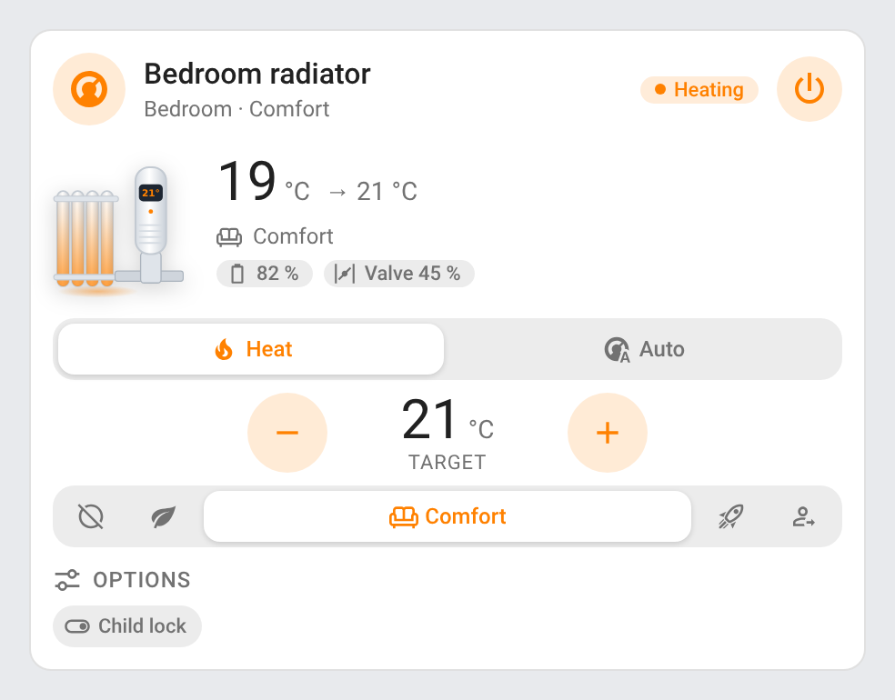</picture> |

All the cards share the same look (header with a status pill and a power button, illustration next to the state, mini cards with a detail button that size to their content in a Sections view), chips that open their entity's more-info on a click, a visual editor in the dashboard UI covering every option (the device cards' entity overrides in its folded **Advanced** section, as YAML), English, French, German, Spanish, Serbian (Cyrillic and Latin), Italian, Dutch, European Portuguese, Polish, Romanian, Danish, Swedish, Bulgarian, Russian, Ukrainian, Hungarian, Slovak, Czech, Slovenian, Latvian and Greek labels following the Home Assistant language, light and dark themes, and come in a single Marketplace install with no dependency.

On narrow cards (6 columns of a Sections view), the status pill keeps only its coloured dot (the status stays in its tooltip), the title keeps its first characters, and the mini cards move their buttons under the device's info.

## Features

### Overview

`custom:climate-air-overview-card` — Every air conditioner, air purifier and fan at a glance.

- Automatic discovery: every `climate` entity, sorted into air conditioners (the ones that can cool, dry or only blow) and thermostats (the others: wall thermostats, radiators, radiator valves), and every `fan` entity, sorted into air purifiers (from their name, or a PM2.5, air quality or filter sensor on the device) and fans
- One compact tile per device with its illustration, animated while it runs like on the device cards (turning blades and rotor, air flowing out, swinging head or flap, warm air rising), coloured by its state: the mode colour of an air conditioner or a thermostat, the air quality of a purifier, blue for a fan
- The state on each tile: *Cool · 22 °C*, *Heating · 21 °C*, *PM2.5 6 · Good air*, *45 % · Natural wind*, or *Off* (with the room temperature for an air conditioner or a thermostat); a chip flags a filter to replace or to clean, an open window or a radiator valve's low battery (a click on it opens that entity's more-info); an air conditioner with a low / high range shows it (*Heat/Cool · 20–24 °C*)
- Grouped by kind of device, by area, or not at all (`group_by`)
- **Tap** the icon of a tile to turn the device on or off; **tap** the tile to unfold its full card at the top of the overview, tap it again or anywhere else to fold it back
- Only the devices that are on or need attention show; the **detail** button (top right) shows every device, and back, as does a click anywhere else. `show_all: true` starts on every device instead, the button then keeping only the devices on or needing attention (`zoom: false`: every device, always, no button)
- Header with how many devices are on and how many need attention (filters, open windows, low batteries)
- The illustration of every device of a kind or of each device (`illustrations`, guessed from the device model otherwise), or an icon instead (`icons`); a name and a type per device (`devices`); the header icon (`icon`). In the visual editor, the **Device types** and **Devices** sections set all of them, without YAML

### Air purifier

`custom:climate-air-purifier-card` — An air purifier (`fan` entity) and the sensors of its device.

- The PM2.5 density (or the air quality index) in large, with its level: *Good air*, *Moderate air*, *Poor air*, *Very poor air*; the card takes the colour of the air quality
- Animated illustration while it runs: the fan turns (faster with the speed), clean air rises and dust is drawn into the intake; the display ring and the floor light take the air quality colour. Four shapes: a tower (a tall box whose display shows the PM2.5), a round purifier, a square box and a Dyson-style bladeless loop, picked from the device model or set with `illustration`
- Filter life bar (with its hours of use on hover) and a *Replace the filter* alert at 10 % or less
- Presets as segmented buttons (Auto, Sleep, Favorite…), or the device's mode select when it has no presets (HomeKit purifiers); speed slider; favorite level in the Favorite preset
- Temperature, humidity, PM10 and, when the device reports them, VOC and NO₂ chips (Dyson); child lock, sound and indicator light toggles

### Fan

`custom:climate-air-fan-card` — A fan (`fan` entity) and the controls of its device.

- The speed in large, with the preset; speed slider and presets (natural wind, straight wind…)
- Animated illustration while it runs: the blades turn faster with the speed, the head swings while oscillating, and the breeze comes in gusts in a natural wind preset
- Oscillation, ionizer, child lock, sound and indicator light toggles; oscillation angle, timer and display brightness; turn left / turn right buttons
- Temperature and humidity chips when the fan measures them

### Air conditioner

`custom:climate-air-aircon-card` — An air conditioner (`climate` entity) and the sensors of its device.

- The room temperature in large and the target next to it; modes as segmented buttons (only the selected one keeps its label when there are many); − / + buttons for the target, sent once the taps stop and kept on screen until the device reports it. In *Heat/Cool* or *Auto* with a low / high range (`target_temp_low` / `target_temp_high`), both ends show with their own − / + (*Heat to*, *Cool to*); the mini card shows the range and leaves its buttons to the full card
- A *Target humidity* slider when the entity supports it (`climate.set_humidity`, within `min_humidity` / `max_humidity`)
- Fan mode, swing mode, horizontal swing mode (when the entity supports it, `climate.set_swing_horizontal_mode`) and preset; the device's other switches (eco, display, self clean, sound…) as option toggles
- Animated illustration while it runs: the air flows out in the mode colour, with snowflakes when cooling, shimmer when heating and droplets when drying; the flap swings with the vertical swing and the airflow sways with the horizontal one; the status light breathes while the compressor runs. Three shapes: a wall split unit, a portable unit with its exhaust hose and a window split (indoor unit, outdoor unit hung outside the window, whose fan turns with the compressor), picked from the device model or set with `illustration`
- Outdoor temperature, humidity and power draw chips; a *Clean the filter* alert from the device's dust sensor

### Thermostat

`custom:climate-air-thermostat-card` — A thermostat (`climate` entity that heats but cannot cool, dry or blow) and the sensors of its device: a wall thermostat, an electric radiator, a radiator valve.

- The room temperature in large and the target next to it, with − / + buttons sent once the taps stop (a low / high range gets both ends, like the air conditioner card); the mode buttons when it has more than one (*Heat*, *Auto*…), off being the power button
- What it does in the status pill (*Heating*, *Idle*, from `hvac_action`), and the heat colour while it heats
- The presets as segmented buttons (*Comfort*, *Eco*, *Away*, *Boost*, frost protection…), a select when there are more than seven
- The valve opening, the battery and the outdoor temperature, humidity and power chips; a *Window open* alert from the device's open-window sensor and a *Low battery* alert at 15 % or less; the device's switches (child lock…) as option toggles
- Animated illustration while it heats: warm air rises, the radiator glows from the bottom up, the dial's flame flickers; the display shows the target, and the dial's arc where it sits between the entity's minimum and maximum. Three shapes: a round wall thermostat, a column radiator and a radiator valve on the corner of its radiator, picked from the device model and name or set with `illustration`

### Mini cards

`custom:climate-air-purifier-mini-card`, `custom:climate-air-fan-mini-card`, `custom:climate-air-aircon-mini-card`, `custom:climate-air-thermostat-mini-card` — The device on two lines, for a compact dashboard.

- The illustration (animated too), the key reading (PM2.5, speed, temperatures, valve) and round buttons: power, plus the preset (purifier), the oscillation (fan) or − / + for the target (air conditioner, thermostat)
- The **detail** button (top right) unfolds the full card, and back, as does a click anywhere else (`zoom: false` removes it)

| Air purifier | Fan | Air conditioner | Thermostat |
|---|---|---|---|
| <picture><source media="(prefers-color-scheme: dark)" srcset="https://raw.githubusercontent.com/juju35/ha-climate-air-card/main/screenshots/purifier-mini-dark.png"></picture> | <picture><source media="(prefers-color-scheme: dark)" srcset="https://raw.githubusercontent.com/juju35/ha-climate-air-card/main/screenshots/fan-mini-dark.png"></picture> | <picture><source media="(prefers-color-scheme: dark)" srcset="https://raw.githubusercontent.com/juju35/ha-climate-air-card/main/screenshots/aircon-mini-dark.png"></picture> | <picture><source media="(prefers-color-scheme: dark)" srcset="https://raw.githubusercontent.com/juju35/ha-climate-air-card/main/screenshots/thermostat-mini-dark.png">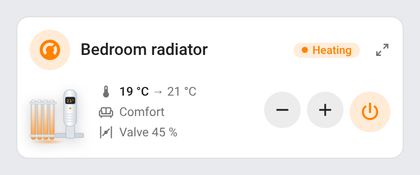</picture> |

## Supported integrations

The cards work with **any integration** that provides air purifiers and fans as `fan` entities, and air conditioners and thermostats as `climate` entities (Xiaomi Home, Xiaomi Miio, HomeKit Device, Matter, Midea, Dyson, Netatmo, tado°, Zigbee2MQTT and ZHA radiator valves, Generic Thermostat…). Some get a specific treatment:

| Integration | What the cards add |
|---|---|
| [HomeKit Device](https://www.home-assistant.io/integrations/homekit_controller/) (built in) | The mode select as presets when the purifier has none; an air quality index on the HomeKit 1–5 scale |
| [Dyson](https://github.com/libdyson-wg/ha-dyson) (Marketplace) | VOC and NO₂ chips, the HEPA filter life, and a bladeless loop illustration |
| [Zigbee2MQTT](https://www.zigbee2mqtt.io/) / [ZHA](https://www.home-assistant.io/integrations/zha/) (built in) radiator valves | The valve opening (`position`, `pi_heating_demand`), the open-window detection and the battery of the valve |

The sensors of the device (PM2.5, temperature, humidity, filter, valve, open window, battery, child lock…) are discovered from its registry, whatever the integration.

## Prerequisites

- Home Assistant 2024.8 or later
- Air purifiers and fans as `fan` entities, air conditioners and thermostats as `climate` entities, from any integration (Xiaomi Home, Xiaomi Miio, HomeKit Device, Matter, Midea, Dyson, Netatmo, tado°, Zigbee radiator valves…)

## Installation

### Via the Marketplace (recommended)

Click the button below to add the repository directly:

[](https://my.home-assistant.io/redirect/marketplace_repository/?owner=juju35&repository=ha-climate-air-card&category=plugin)

Or manually:

1. Open **Settings → Marketplace → Add from link** (top right; this needs a GitHub account connected)
2. Add `https://github.com/juju35/ha-climate-air-card` — Category: **Dashboard**
3. Open **Climate Air Cards** and click **Install**
4. Clear your browser cache and refresh

The Marketplace registers the dashboard resource for you; the single file provides every card.

### Manual

1. Download `ha-climate-air-card.js` from the [latest release](https://github.com/juju35/ha-climate-air-card/releases/latest)
2. Copy it to `/config/www/`
3. Go to **Settings → Dashboards → Resources** → Add resource:
   - URL: `/local/ha-climate-air-card.js`
   - Type: **JavaScript Module**
4. Clear your browser cache and refresh

## Configuration

### Common options

The purifier, fan, air conditioner and thermostat cards, and their mini cards, share these options.

| Option | Required | Default | Description |
|---|---|---|---|
| `entity` | ❌ | First found | The `fan` or `climate` entity of the device; without it, the card takes the first device of its kind |
| `name` | ❌ | Device name | Card title |
| `icon` | ❌ | Illustration | Replaces the illustration with an icon |
| `illustration` | ❌ | `auto` | Purifier: `tower`, `cylinder`, `box` or `dyson` (bladeless loop); air conditioner: `split`, `portable` or `window`; thermostat: `dial` (round wall thermostat), `radiator` or `valve` (radiator valve). `auto` picks one from the device model and name |
| `show_controls` | ❌ | `true` | Show the controls (presets, speed, modes, options) |
| `show_sensors` | ❌ | `true` | Show the measurement chips (temperature, humidity, PM10, outdoor temperature, power, valve, battery) |
| `show_alerts` | ❌ | `true` | Purifier, air conditioner and thermostat cards only: show the filter, open window and low battery alerts (the fan cards have none) |
| `zoom` | ❌ | `true` | Mini cards only: detail button at the top right that unfolds the full card (a click elsewhere folds it back) |
| `language` | ❌ | Auto | Force language: `en`, `fr`, `de`, `es`, `sr`, `sr-Latn`, `it`, `nl`, `pt`, `pl`, `ro`, `da`, `sv`, `bg`, `ru`, `uk`, `hu`, `sk`, `cs`, `sl`, `lv` or `el` (auto-detects from HA settings; `pt-BR` gets European Portuguese); also on the Overview card |
| `entities` | ❌ | Auto | Override the sensors and controls found on the device (see [Entity overrides](#entity-overrides)) |

### Overview

Minimal:

```yaml
type: custom:climate-air-overview-card
```

Full options:

```yaml
type: custom:climate-air-overview-card
title: Climate & air
icon: mdi:home-thermometer
group_by: type
columns: 2
zoom: true
show_all: false
exclude:
  - fan.garage_fan
include:
  - climate.bathroom_thermostat
illustrations:
  aircon: window
  thermostat: valve
  fan.bedroom_air: box
icons:
  fan.garage_fan: mdi:ceiling-fan
devices:
  - entity: fan.bedroom_air
    name: Bedroom
    type: purifier
```

| Option | Required | Default | Description |
|---|---|---|---|
| `title` | ❌ | Climate & air | Card title |
| `icon` | ❌ | `mdi:air-filter` | Header icon |
| `illustrations` | ❌ | Auto | Tile illustrations, by kind of device (`aircon`, `thermostat`, `purifier`) and by entity ID, the device's own winning: purifier `tower`, `cylinder`, `box` or `dyson`; air conditioner `split`, `portable` or `window`; thermostat `dial`, `radiator` or `valve`. Unset or `auto`: guessed from the device model and name. The unfolded card uses the same one. In the visual editor's **Device types** and **Devices** sections |
| `icons` | ❌ | — | An icon instead of the illustration, by kind of device (`aircon`, `thermostat`, `purifier`, `fan`) or by entity ID; it moves with the device state (turning fan, mode icon of an air conditioner, flickering radiator of a thermostat that heats). In the visual editor's **Device types** and **Devices** sections |
| `group_by` | ❌ | `type` | `type` (air conditioners, thermostats, air purifiers, fans), `area` or `none`. With `area`, the heading shows the area's icon and name, and each tile is labelled by its kind of device (Air purifier, Air conditioner, Thermostat…) instead of repeating the room — a `name` set in `devices` still wins |
| `columns` | ❌ | `2` | Number of tile columns (1 on narrow cards unless set) |
| `zoom` | ❌ | `true` | Only the devices on or needing attention show, and a detail button shows them all; `false`: every device, always |
| `show_all` | ❌ | `false` | Every device shows at first, and the detail button keeps only the ones on or needing attention (a click elsewhere brings every device back). In the visual editor: **Show every device** |
| `show_alerts` | ❌ | `true` | Filter alerts on the purifier and air conditioner tiles, open window and low battery alerts on the thermostat tiles (a device needing attention shows even when off, with `zoom`); `false`: none |
| `exclude` | ❌ | — | Devices left out |
| `include` | ❌ | — | `climate` or `fan` entities the card would not pick on its own (a hidden entity) |
| `devices` | ❌ | — | Per-device overrides: `{entity, name, icon, illustration, type}`, with `type` one of `aircon`, `thermostat`, `purifier`, `fan` (they win over `icons` and `illustrations`) |

### Air purifier

```yaml
type: custom:climate-air-purifier-card
entity: fan.living_room_purifier
illustration: cylinder
```

### Fan

```yaml
type: custom:climate-air-fan-card
entity: fan.bedroom_fan
```

### Air conditioner

```yaml
type: custom:climate-air-aircon-card
entity: climate.air_conditioner
illustration: window
```

### Thermostat

```yaml
type: custom:climate-air-thermostat-card
entity: climate.bedroom_radiator
illustration: valve
```

### Entity overrides

The cards find the other entities of the device by their registry translation key, their entity ID (English, French, German or Spanish) or their device class. Set one under `entities` when the card picks the wrong one or misses it:

| Key | Domain | Card | Used for |
|---|---|---|---|
| `pm25` / `pm10` | `sensor` | Purifier | Particle density, air quality colour |
| `voc` / `no2` | `sensor` | Purifier | Volatile organic compounds and nitrogen dioxide index (Dyson) |
| `aqi` | `sensor` | Purifier | Air quality index, when there is no PM2.5 sensor. A value of 5 or less is read on the HomeKit 1–5 scale, above that as a US AQI |
| `filter` / `filter_hours` | `sensor` | Purifier | Filter life (%) and hours of use. Dyson's HEPA (or combined) filter is used, not its carbon one |
| `status` | `sensor` | Purifier | State shown while on (*Purifying*, *Idle*…) |
| `mode` | `select` | Purifier | Mode buttons, when the fan entity has no presets |
| `favorite` | `number` | Purifier | Favorite level |
| `temperature` / `humidity` | `sensor` | Purifier, fan, air conditioner and thermostat (humidity) | Measurement chips |
| `angle` | `number` / `select` | Fan | Oscillation angle |
| `timer` | `number` | Fan | Timer |
| `rotate_left` / `rotate_right` | `button` | Fan | Turn buttons |
| `brightness` | `select` | Fan | Display brightness |
| `anion` / `child_lock` / `buzzer` | `switch` | Purifier, fan | Option toggles |
| `light` | `light` | Purifier, fan | Indicator light toggle |
| `indoor_temp` / `outdoor_temp` | `sensor` | Air conditioner, thermostat | Room temperature (when the climate entity has none) and outdoor chip |
| `power` | `sensor` | Air conditioner, thermostat | Power draw chip |
| `compressor` | `sensor` | Air conditioner | Compressor frequency: the status light breathes while it runs |
| `filter_alert` | `binary_sensor` | Air conditioner | *Clean the filter* alert |
| `valve` | `sensor` / `number` | Thermostat | Valve opening (%): its chip, and whether a valve without `hvac_action` heats |
| `window` | `binary_sensor` | Thermostat | *Window open* alert (the valve's open-window detection) |
| `battery` | `sensor` | Thermostat | Battery chip, and the *Low battery* alert at 15 % or less |

```yaml
entities:
  pm25: sensor.living_room_pm2_5
  filter: sensor.living_room_purifier_filter_life
```

## Screenshots

Every card comes alive while its device is on, and settles to a still card once it is off. All of this honours `prefers-reduced-motion`: animations stop for anyone who asks their system to reduce motion.

The air purifier draws air in: the side inlets pull it through, the base glows and a stream of clean air rises out of the top.

| Light | Dark |
|---|---|
|  |  |

A Dyson-style bladeless purifier has no blades to turn: clean air streams up through its hollow loop instead.

| Light | Dark |
|---|---|
|  |  |

The fan spins its blades, the head slowly oscillates from side to side, and gusts of air stream out in front of it.

| Light | Dark |
|---|---|
|  |  |

The air conditioner swings its louvres while the cooled air falls out of the vent.

| Light | Dark |
|---|---|
|  |  |

Heating, the warm air shimmers as it rises out of the vent.

| Light | Dark |
|---|---|
|  |  |

Drying, droplets fall from the vent instead.

| Light | Dark |
|---|---|
|  |  |

The thermostat heats: the radiator under its valve glows from the bottom up and warm air rises from it.

| Light | Dark |
|---|---|
| 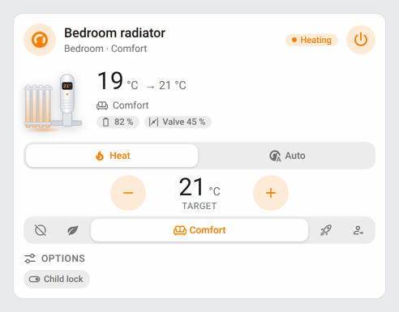 | 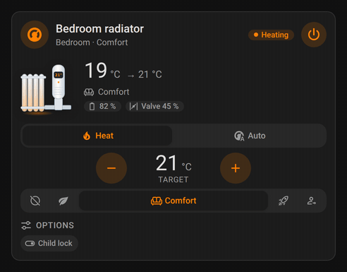 |

A round wall thermostat heating: its flame flickers and warm air rises above it; the arc shows where the target sits.

| Light | Dark |
|---|---|
| 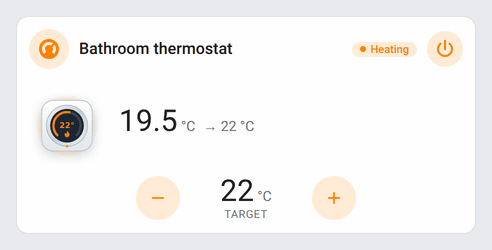 | 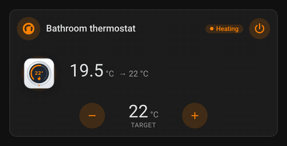 |

A column radiator heating: every column glows and warm air rises above it.

| Light | Dark |
|---|---|
| 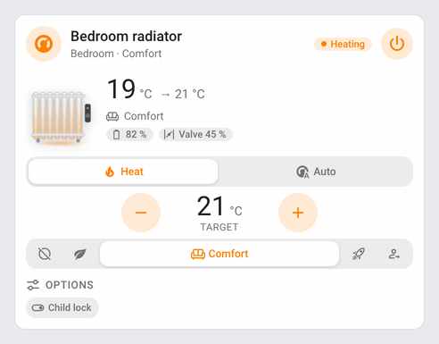 | 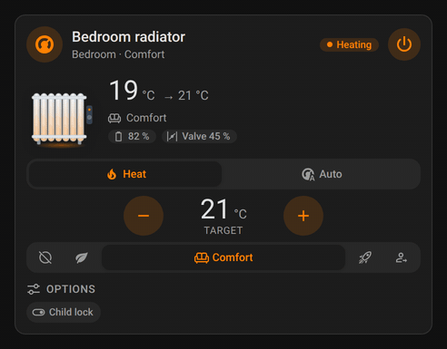 |

The overview gathers every device: each tile's icon moves to match its appliance and its status ring breathes around it.

| Light | Dark |
|---|---|
|  |  |

| | Light | Dark |
|---|---|---|
| Overview, devices on |  |  |
| Overview grouped by area, tiles labelled by kind |  |  |
| Overview, a device unfolded |  |  |
| Air purifier, filter to replace |  |  |
| Air purifier, round and box |   |   |
| Air purifier, Dyson bladeless |  |  |
| Fan |  |  |
| Air conditioner, heating |  |  |
| Air conditioner, heat / cool range |  |  |
| Air conditioner, drying to a target humidity |  |  |
| Thermostat, open window and low battery | 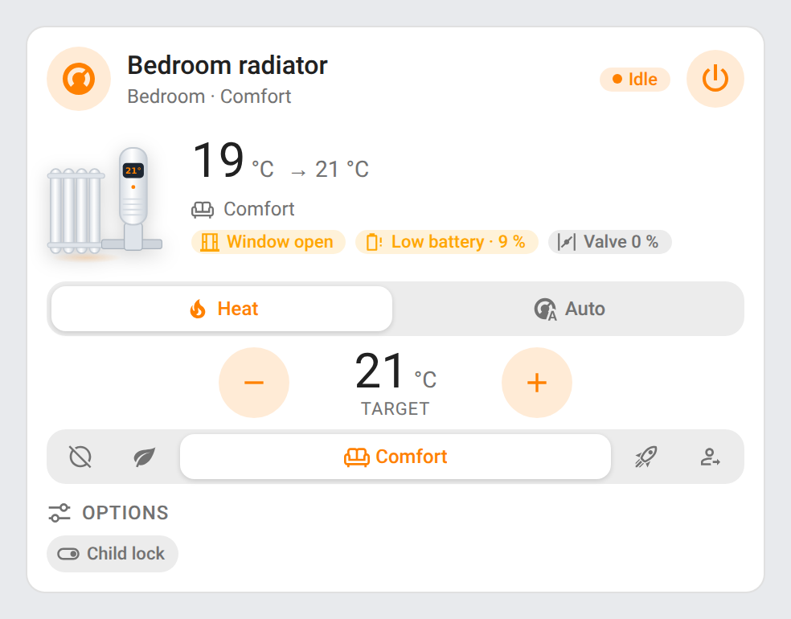 | 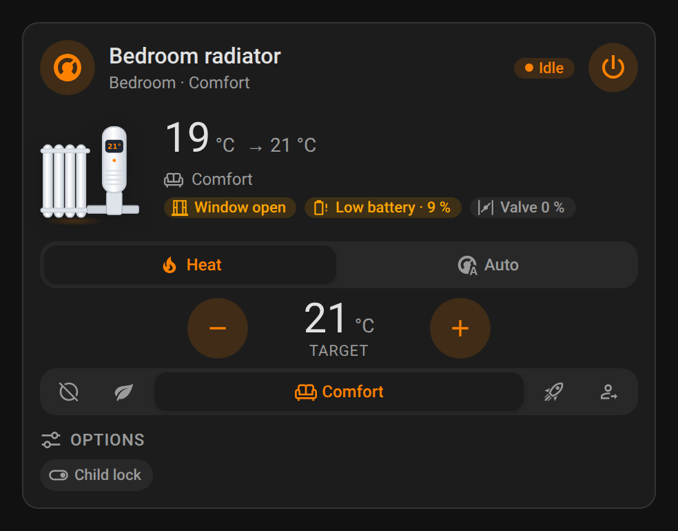 |
| Thermostat, wall dial and radiator | 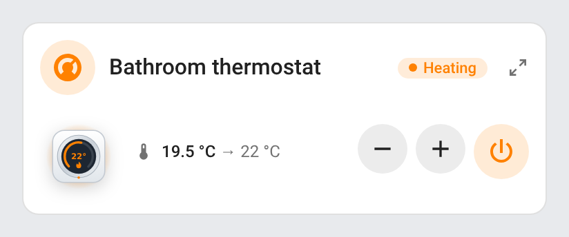 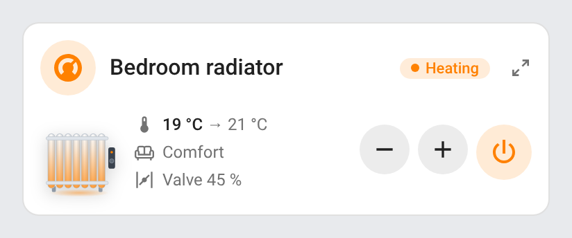 | 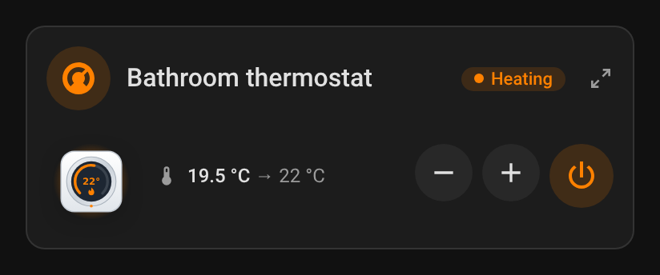 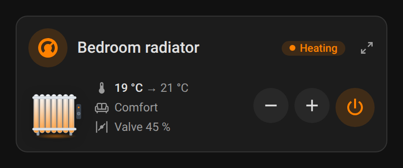 |
| Air conditioner, portable and window split |   |   |

## Development

```bash
npm install
npm run build        # bundles src/*.js into dist/ha-climate-air-card.js and stamps the version of package.json
npm run check        # builds and checks the bundle (run in CI)
npm test             # unit tests, no browser
npm run screenshots  # renders every card (and a looping gif per animation: purifier/fan/aircon cool, heat and dry/thermostat valve, dial and radiator/overview, needs ffmpeg) with mock data into screenshots/
```

Each card has its own source in `src/`, next to `src/shared.js`; the build wraps each one in its own block and concatenates them into the single file the Marketplace installs. `dist/` is not committed: `npm run build` creates it locally, CI builds it on every push, and the release workflow attaches the built file to the release, which is where the Marketplace installs it from.

### Releasing

1. Bump `version` in `package.json`
2. Add a `## <version>` section at the top of [CHANGELOG.md](https://github.com/juju35/ha-climate-air-card/blob/main/CHANGELOG.md)
3. Push to `main`: the **Release** workflow builds the bundle, creates the tag and the GitHub release with the changelog section as notes, and attaches `ha-climate-air-card.js`

## Translations

The cards auto-detect the language from your Home Assistant settings. Currently supported:

| Language | Code |
|---|---|
| English | `en` |
| Français | `fr` |
| Deutsch | `de` |
| Español | `es` |
| Српски | `sr` |
| Srpski (latinica) | `sr-Latn` |
| Italiano | `it` |
| Nederlands | `nl` |
| Português (Portugal) | `pt` |
| Polski | `pl` |
| Română | `ro` |
| Dansk | `da` |
| Svenska | `sv` |
| Български | `bg` |
| Русский | `ru` |
| Українська | `uk` |
| Magyar | `hu` |
| Slovenčina | `sk` |
| Čeština | `cs` |
| Slovenščina | `sl` |
| Latviešu | `lv` |
| Ελληνικά | `el` |

Contributions for additional languages are welcome!

## License

[MIT](https://github.com/juju35/ha-climate-air-card/blob/main/LICENSE)

## Support

If you find this project useful, you can support its development:

<a href="https://buymeacoffee.com/julienstep9"></a>
