# ha-climate-air-card

[](https://www.home-assistant.io/integrations/marketplace/)
[](https://github.com/juju35/ha-climate-air-card/actions/workflows/hacs.yml)
[](https://github.com/juju35/ha-climate-air-card/actions/workflows/validate.yml)
[](https://github.com/juju35/ha-climate-air-card/actions/workflows/lint.yml)
[](https://github.com/juju35/ha-climate-air-card/releases/latest)
[](https://github.com/juju35/ha-climate-air-card/blob/main/LICENSE)
[](https://buymeacoffee.com/julienstep9)

<p align="center"></p>

<p align="center">
  &nbsp;&nbsp;
  &nbsp;&nbsp;
  &nbsp;&nbsp;
  &nbsp;&nbsp;
  &nbsp;&nbsp;
  &nbsp;&nbsp;
  &nbsp;&nbsp;
  &nbsp;&nbsp;
  &nbsp;&nbsp;
  &nbsp;&nbsp;
  &nbsp;&nbsp;
  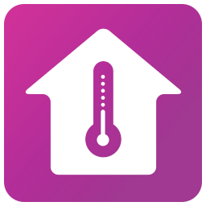&nbsp;&nbsp;
  &nbsp;&nbsp;
  &nbsp;&nbsp;
  
</p>

Lovelace cards for Home Assistant's **heat pumps, air conditioners, air purifiers, humidifiers, dehumidifiers, essential oil diffusers and fans**: one card per kind of device, each with a mini card, and an overview of every device of the instance. Add a card, it finds the device and its sensors by itself. The illustrations come alive while a device runs. Thermostats and radiators have their own cards in [ha-heating-card](https://github.com/juju35/ha-heating-card) (see [Coming from 1.x](#coming-from-1x-thermostats)).

[](https://my.home-assistant.io/redirect/marketplace_repository/?owner=juju35&repository=ha-climate-air-card&category=plugin)

| Card | Type | What it shows |
|---|---|---|
| [Overview](#overview) | `custom:climate-air-overview-card` | Every heat pump, air conditioner, air purifier, humidifier, diffuser and fan at a glance: one tile per device, tap a tile to unfold its full card. |
| [Air purifier](#air-purifier) | `custom:climate-air-purifier-card` | Air quality, filter life, presets, speed and options of an air purifier. |
| [Air purifier mini](#mini-cards) | `custom:climate-air-purifier-mini-card` | The same purifier on two lines, with a zoom to the full card. |
| [Fan](#fan) | `custom:climate-air-fan-card` | Speed, oscillation, presets, angle, timer and options of a fan. |
| [Fan mini](#mini-cards) | `custom:climate-air-fan-mini-card` | The same fan on two lines, with a zoom to the full card. |
| [Air conditioner](#air-conditioner) | `custom:climate-air-aircon-card` | Mode, target temperature, fan and swing, measurements and options of an air conditioner. |
| [Air conditioner mini](#mini-cards) | `custom:climate-air-aircon-mini-card` | The same air conditioner on two lines, with a zoom to the full card. |
| [Heat pump](#heat-pump) | `custom:climate-air-heatpump-card` | Mode, target temperature, hot water tank and measurements of an air-to-water heat pump, with an animated outdoor unit. |
| [Heat pump mini](#mini-cards) | `custom:climate-air-heatpump-mini-card` | The same heat pump on two lines, with a zoom to the full card. |
| [Humidifier](#humidifier) | `custom:climate-air-humidifier-card` | Humidity, target, modes and water tank of a humidifier, a dehumidifier or an essential oil diffuser, with a large animated illustration. |
| [Humidifier mini](#mini-cards) | `custom:climate-air-humidifier-mini-card` | The same device on two lines, with a zoom to the full card. |

| Overview | Air purifier | Fan | Air conditioner |
|---|---|---|---|
| <picture><source media="(prefers-color-scheme: dark)" srcset="https://raw.githubusercontent.com/juju35/ha-climate-air-card/main/screenshots/overview-all-dark.png">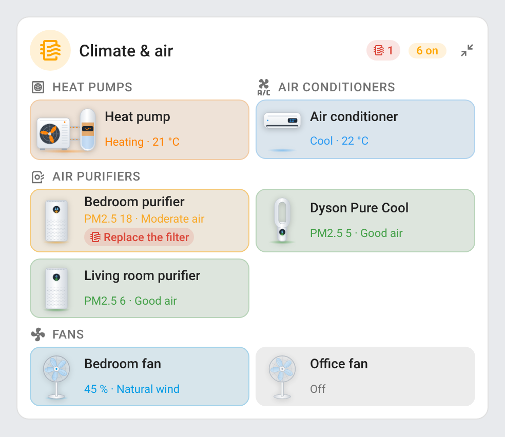</picture> | <picture><source media="(prefers-color-scheme: dark)" srcset="https://raw.githubusercontent.com/juju35/ha-climate-air-card/main/screenshots/purifier-card-dark.png">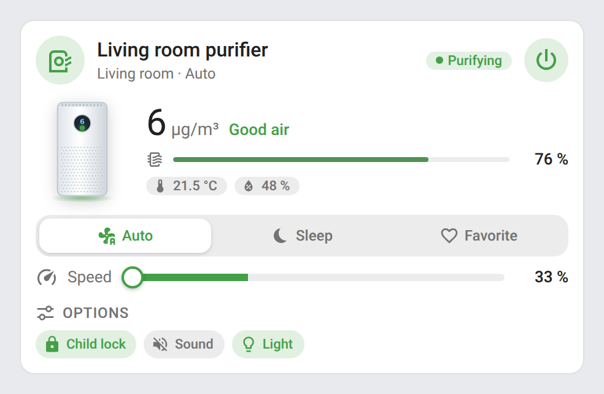</picture> | <picture><source media="(prefers-color-scheme: dark)" srcset="https://raw.githubusercontent.com/juju35/ha-climate-air-card/main/screenshots/fan-card-dark.png">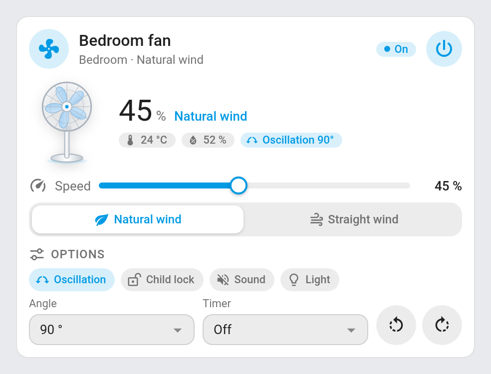</picture> | <picture><source media="(prefers-color-scheme: dark)" srcset="https://raw.githubusercontent.com/juju35/ha-climate-air-card/main/screenshots/aircon-card-dark.png">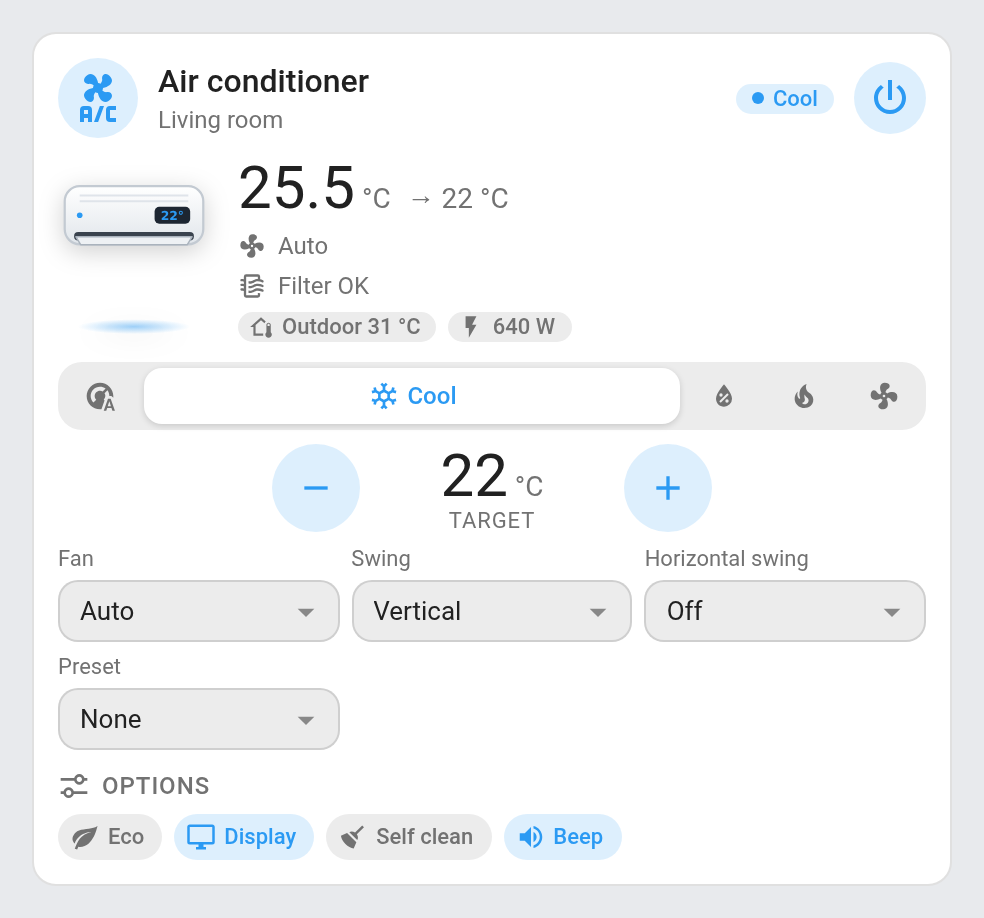</picture> |

All the cards share the same look (header with a status pill and a power button, illustration next to the state, mini cards with a detail button that size to their content in a Sections view), chips that open their entity's more-info on a click, a visual editor in the dashboard UI covering every option (the device cards' entity overrides in its folded **Advanced** section, as YAML), English, French, German, Spanish, Serbian (Cyrillic and Latin), Italian, Dutch, European Portuguese, Polish, Romanian, Danish, Swedish, Bulgarian, Russian, Ukrainian, Hungarian, Slovak, Czech, Slovenian, Latvian and Greek labels following the Home Assistant language, light and dark themes, and come in a single Marketplace install with no dependency.

On narrow cards (6 columns of a Sections view), the status pill keeps only its coloured dot (the status stays in its tooltip), the title keeps its first characters, and the mini cards move their buttons under the device's info.

## Features

### Overview

`custom:climate-air-overview-card` — Every air conditioner, air purifier and fan at a glance.

- Automatic discovery: every `climate` entity that can cool, dry or only blow (a heat-only thermostat is left out: [ha-heating-card](https://github.com/juju35/ha-heating-card) shows those), and every `fan` entity, sorted into air purifiers (from their name, or a PM2.5, air quality or filter sensor on the device) and fans
- One compact tile per device with its illustration, animated while it runs like on the device cards (turning blades and rotor, air flowing out, swinging head or flap), coloured by its state: the mode colour of an air conditioner, the air quality of a purifier, blue for a fan
- The state on each tile: *Cool · 22 °C*, *PM2.5 6 · Good air*, *45 % · Natural wind*, or *Off* (with the room temperature for an air conditioner); a chip flags a filter to replace or to clean (a click on it opens that entity's more-info); an air conditioner with a low / high range shows it (*Heat/Cool · 20–24 °C*)
- Grouped by kind of device, by area, or not at all (`group_by`)
- **Tap** the icon of a tile to turn the device on or off; **tap** the tile to unfold its full card at the top of the overview, tap it again or anywhere else to fold it back
- Only the devices that are on or need attention show; the **detail** button (top right) shows every device, and back, as does a click anywhere else. `show_all: true` starts on every device instead, the button then keeping only the devices on or needing attention (`zoom: false`: every device, always, no button)
- Header with how many devices are on and how many filters need care
- The illustration of every device of a kind or of each device (`illustrations`, guessed from the device model otherwise), or an icon instead (`icons`); a name and a type per device (`devices`); the header icon (`icon`). In the visual editor, the **Device types** and **Devices** sections set all of them, without YAML

### Air purifier

`custom:climate-air-purifier-card` — An air purifier (`fan` entity) and the sensors of its device.

- The PM2.5 density (or the air quality index) in large, with its level: *Good air*, *Moderate air*, *Poor air*, *Very poor air*; the card takes the colour of the air quality
- Animated illustration while it runs: the fan turns (faster with the speed), clean air rises and dust is drawn into the intake; the display ring and the floor light take the air quality colour. Four shapes: a tower (a tall box whose display shows the PM2.5), a round purifier, a square box and a Dyson-style bladeless loop, picked from the device model or set with `illustration`
- Filter life bar (with its hours of use on hover) and a *Replace the filter* alert at 10 % or less
- Presets as segmented buttons (Auto, Sleep, Favorite…), or the device's mode select when it has no presets (HomeKit purifiers); speed slider; favorite level in the Favorite preset
- Temperature, humidity, PM10 and, when the device reports them, VOC and NO₂ chips (Dyson); child lock, sound and indicator light toggles

### Fan

`custom:climate-air-fan-card` — A fan (`fan` entity) and the controls of its device.

- The speed in large, with the preset; speed slider and presets (natural wind, straight wind…)
- Animated illustration while it runs: the blades turn faster with the speed, the head swings while oscillating, and the breeze comes in gusts in a natural wind preset
- Oscillation, ionizer, child lock, sound and indicator light toggles; oscillation angle, timer and display brightness; turn left / turn right buttons
- Temperature and humidity chips when the fan measures them

### Air conditioner

`custom:climate-air-aircon-card` — An air conditioner (`climate` entity) and the sensors of its device.

- The room temperature in large and the target next to it; modes as segmented buttons (only the selected one keeps its label when there are many); − / + buttons for the target, sent once the taps stop and kept on screen until the device reports it. In *Heat/Cool* or *Auto* with a low / high range (`target_temp_low` / `target_temp_high`), both ends show with their own − / + (*Heat to*, *Cool to*); the mini card shows the range and leaves its buttons to the full card
- A *Target humidity* slider when the entity supports it (`climate.set_humidity`, within `min_humidity` / `max_humidity`)
- Fan mode, swing mode, horizontal swing mode (when the entity supports it, `climate.set_swing_horizontal_mode`) and preset; the device's other switches (eco, display, self clean, sound…) as option toggles
- Animated illustration while it runs: the air flows out in the mode colour, with snowflakes when cooling, shimmer when heating and droplets when drying; the flap swings with the vertical swing and the airflow sways with the horizontal one; the status light breathes while the compressor runs. Three shapes: a wall split unit, a portable unit with its exhaust hose and a window split (indoor unit, outdoor unit hung outside the window, whose fan turns with the compressor), picked from the device model or set with `illustration`
- Outdoor temperature, humidity and power draw chips; a *Clean the filter* alert from the device's dust sensor

### Heat pump

`custom:climate-air-heatpump-card` — An air-to-water heat pump: its `climate` entity, or the `select` of its mode when it has none (Aldes T.One through the TOUG gateway), and the entities of its device.

- Found by itself: a `climate` entity whose device has a hot water tank (`water_heater`) or is named as a heat pump (Altherma, Aquarea, Ecodan, Yutaki, Alfea, Vitocal…), and a mode `select` with an *Off* option on a heat pump device without a climate entity (TOUG). It is not listed as an air conditioner, even when it can cool
- The room temperature in large with the target, and the hot water tank with its target; modes as segmented buttons and − / + for the target. Driven by a select: its modes as buttons (*Off*, *Confort*, *Eco*, *Boost*, *Prog A*…, a dropdown beyond five) and the setpoint slider from its thermostat `number`; the power button goes back to the last mode it ran in
- A *Hot water* section when the device has a `water_heater`: its target slider and its operation modes
- What it does in the status pill: *Heating*, *Cooling*, *Hot water* (the three-way valve sends the heat to the tank), *Idle*, *Defrosting*; *Defrosting* and *Backup heater* chips, outdoor temperature and power draw chips
- Animated illustration: the outdoor unit's fan spins behind its grille while the compressor runs, the water flows in the pipes to the tank, warm air rises above the unit when heating and snowflakes when cooling, heat rises above the tank while it heats the hot water and frost covers the unit while it defrosts; the tank's level follows its temperature and its display shows it

| Heating | Hot water | Defrosting |
|---|---|---|
| <picture><source media="(prefers-color-scheme: dark)" srcset="https://raw.githubusercontent.com/juju35/ha-climate-air-card/main/screenshots/heatpump-card-dark.png">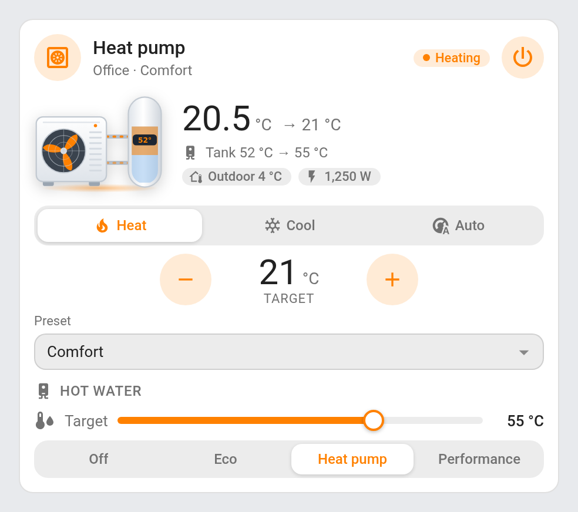</picture> | <picture><source media="(prefers-color-scheme: dark)" srcset="https://raw.githubusercontent.com/juju35/ha-climate-air-card/main/screenshots/heatpump-dhw-dark.png">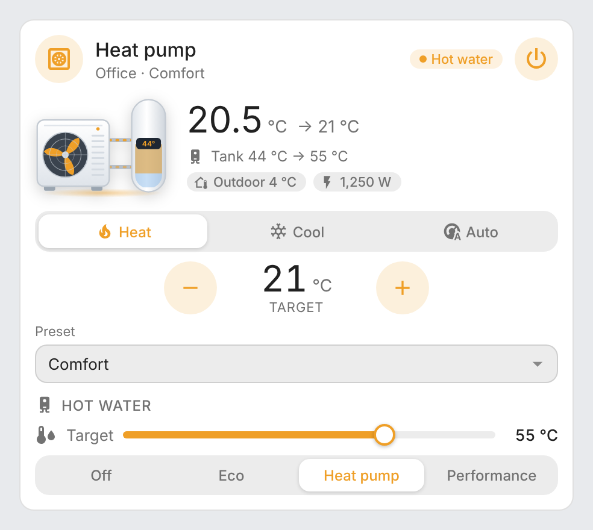</picture> | <picture><source media="(prefers-color-scheme: dark)" srcset="https://raw.githubusercontent.com/juju35/ha-climate-air-card/main/screenshots/heatpump-defrost-dark.png">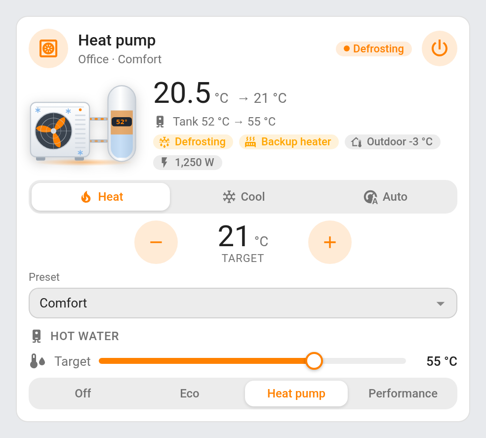</picture> |

### Humidifier

`custom:climate-air-humidifier-card` — A humidifier, a dehumidifier or an essential oil diffuser (`humidifier` entity) and the sensors of its device.

- Found by itself: every `humidifier` entity; its `device_class` (`dehumidifier`) and its model or name pick the illustration
- The room humidity in large with the target next to it; modes as segmented buttons and a *Target humidity* slider (`humidifier.set_humidity`, within `min_humidity` / `max_humidity`). A diffuser has no target (HomeKit reports 100 %) but a *Mist intensity* slider (the VOCOlinc FlowerBud's *Spray quantity*, 1 to 5)
- What it does in the status pill: *Humidifying*, *Drying*, *Diffusing*, *Idle*; *Water tank empty* (humidifier) or *Bucket full* (dehumidifier) as a red alert, on the card and the Overview tile
- A *Mood light* section when the device's light can change brightness or colour (the VOCOlinc mood light), usable while the device itself is off: on / off, *Brightness* slider and colour swatches (a warm white when it supports colour temperature); the illustration follows its colour and brightness
- The water left in the tank (or the bucket) as a bar, the filter of an evaporative humidifier, temperature chip; the device's light (the VOCOlinc ambient light), child lock, sound and other switches as option toggles
- Large animated illustration: mist rises while it humidifies, the water in the tank waves and turns red once nearly empty, dry air leaves a dehumidifier while drops fall into its bucket. Six shapes, picked from the device or set with `illustration`: `column` (ultrasonic), `tank` (clear tank on its base, Xiaomi / Deerma style), `evaporative` (fan and wick), `vocolinc` (VOCOlinc MistFlow, its light ring lit in the colour of its light), `diffuser` (VOCOlinc FlowerBud essential oil diffuser, its frosted cone lit in the colour of its mood light) and `dehumidifier`

| Humidifier | VOCOlinc MistFlow | Essential oil diffuser | Dehumidifier |
|---|---|---|---|
| <picture><source media="(prefers-color-scheme: dark)" srcset="https://raw.githubusercontent.com/juju35/ha-climate-air-card/main/screenshots/humidifier-card-dark.png">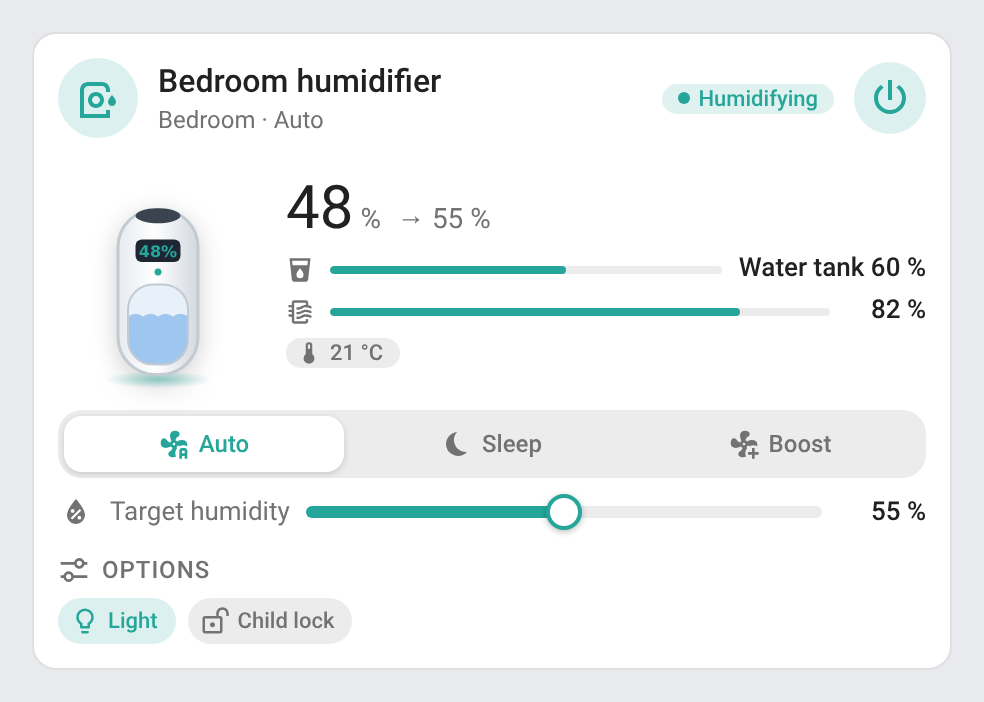</picture> | <picture><source media="(prefers-color-scheme: dark)" srcset="https://raw.githubusercontent.com/juju35/ha-climate-air-card/main/screenshots/humidifier-vocolinc-dark.png">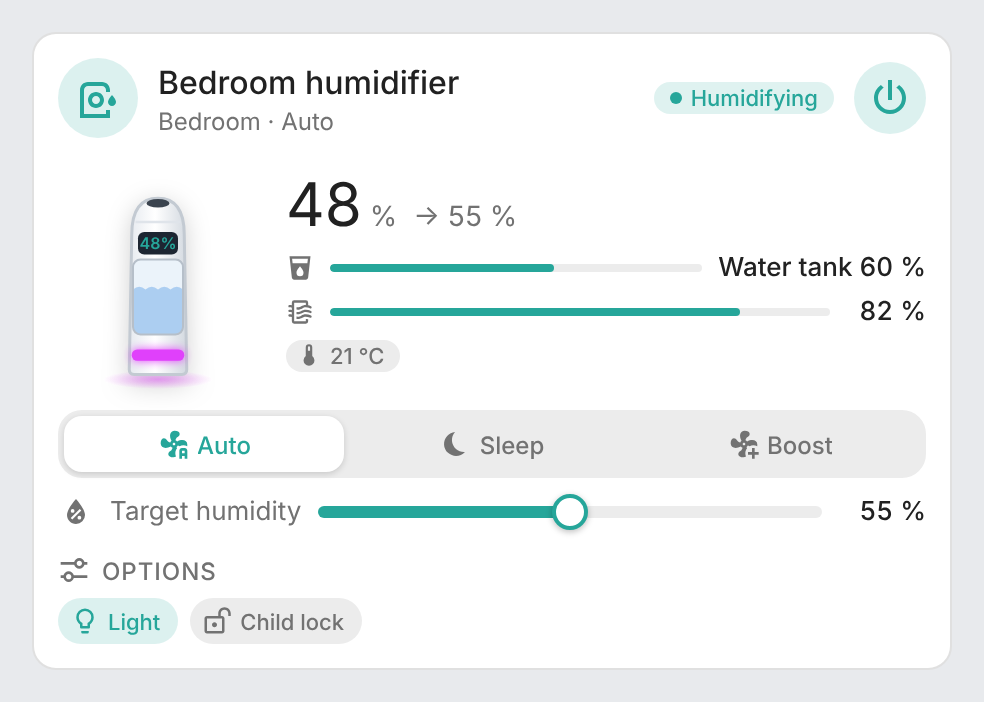</picture> | <picture><source media="(prefers-color-scheme: dark)" srcset="https://raw.githubusercontent.com/juju35/ha-climate-air-card/main/screenshots/humidifier-diffuser-dark.png">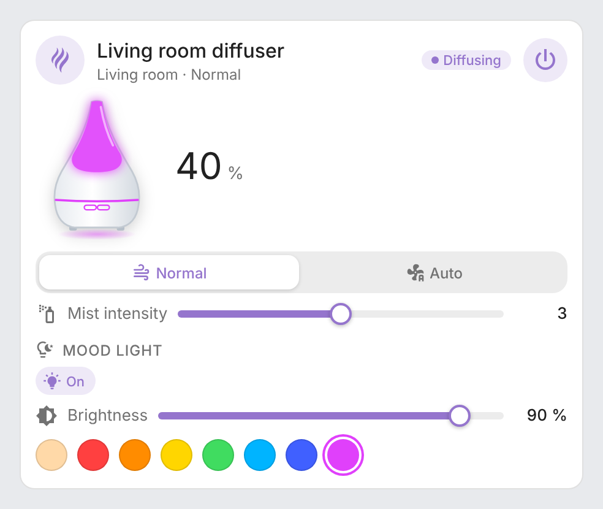</picture> | <picture><source media="(prefers-color-scheme: dark)" srcset="https://raw.githubusercontent.com/juju35/ha-climate-air-card/main/screenshots/humidifier-dehumidifier-dark.png">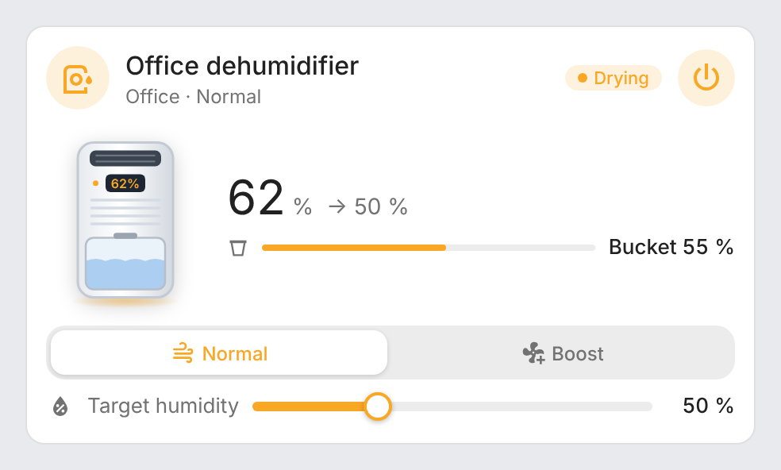</picture> |

### Mini cards

`custom:climate-air-purifier-mini-card`, `custom:climate-air-fan-mini-card`, `custom:climate-air-aircon-mini-card`, `custom:climate-air-heatpump-mini-card`, `custom:climate-air-humidifier-mini-card` — The device on two lines, for a compact dashboard.

- The illustration (animated too), the key reading (PM2.5, speed, temperatures, the heat pump's tank and outdoor temperature, the humidifier's humidity and tank) and round buttons: power, plus the preset (purifier), the mode (humidifier), the oscillation (fan) or − / + for the target (air conditioner, heat pump with a climate entity)
- The **detail** button (top right) unfolds the full card, and back, as does a click anywhere else (`zoom: false` removes it)

| Air purifier | Fan | Air conditioner | Heat pump |
|---|---|---|---|
| <picture><source media="(prefers-color-scheme: dark)" srcset="https://raw.githubusercontent.com/juju35/ha-climate-air-card/main/screenshots/purifier-mini-dark.png">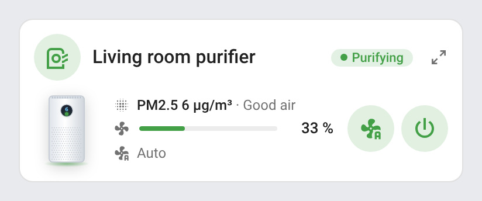</picture> | <picture><source media="(prefers-color-scheme: dark)" srcset="https://raw.githubusercontent.com/juju35/ha-climate-air-card/main/screenshots/fan-mini-dark.png">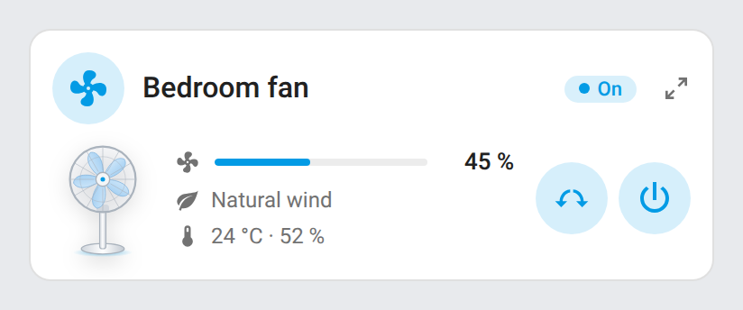</picture> | <picture><source media="(prefers-color-scheme: dark)" srcset="https://raw.githubusercontent.com/juju35/ha-climate-air-card/main/screenshots/aircon-mini-dark.png">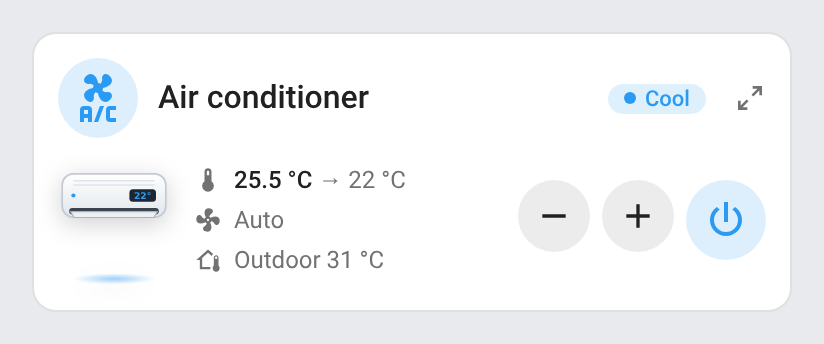</picture> | <picture><source media="(prefers-color-scheme: dark)" srcset="https://raw.githubusercontent.com/juju35/ha-climate-air-card/main/screenshots/heatpump-mini-dark.png">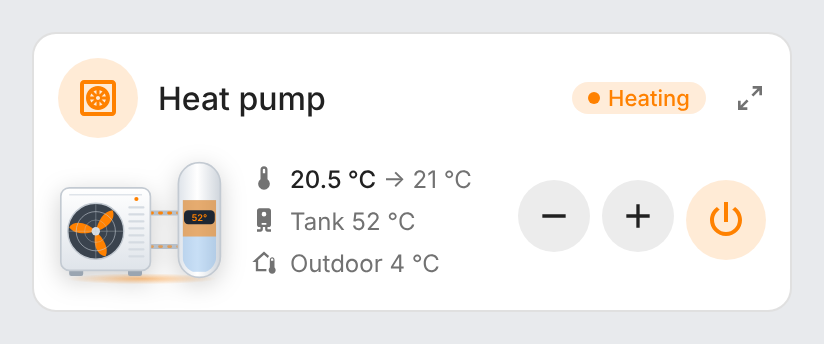</picture> |

| Humidifier | Essential oil diffuser |
|---|---|
| <picture><source media="(prefers-color-scheme: dark)" srcset="https://raw.githubusercontent.com/juju35/ha-climate-air-card/main/screenshots/humidifier-mini-dark.png">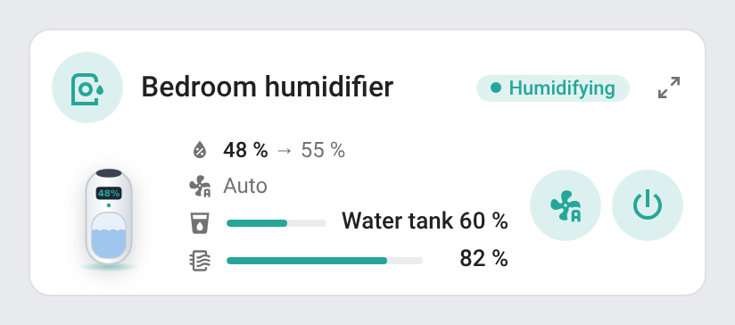</picture> | <picture><source media="(prefers-color-scheme: dark)" srcset="https://raw.githubusercontent.com/juju35/ha-climate-air-card/main/screenshots/humidifier-diffuser-mini-dark.png">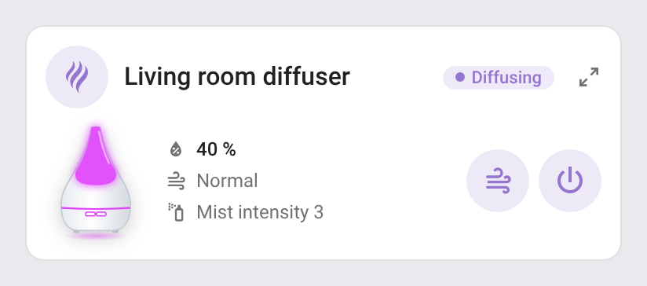</picture> |

## Supported integrations

The cards work with **any integration** that provides air purifiers and fans as `fan` entities air conditioners and heat pumps as `climate` entities, and humidifiers, dehumidifiers and diffusers as `humidifier` entities (Xiaomi Home, Xiaomi Miio, HomeKit Device, Matter, Midea, Dyson, Daikin Onecta, Panasonic Aquarea, MELCloud, Overkiz, ViCare, myUplink…). Some get a specific treatment:

| Integration | What the cards add |
|---|---|
|  [Xiaomi Home](https://github.com/XiaoMi/ha_xiaomi_home) (Marketplace) | Purifiers, fans and humidifiers (Smartmi, Deerma…): the illustration from the model, the filter life, the water level and the child lock, indicator light and sound of the device |
|  [Xiaomi Miio](https://www.home-assistant.io/integrations/xiaomi_miio/) (built in) | The same devices through the local protocol: presets, favorite level, filter life, water level and dry mode of the humidifiers |
|  [Matter](https://www.home-assistant.io/integrations/matter/) (built in) | Purifiers, fans, air conditioners and heat pumps from their standard entities, with the filter condition when the device reports it |
|  [Midea AC LAN](https://github.com/wuwentao/midea_ac_lan) (Marketplace) | Air conditioners and dehumidifiers: the dehumidifier illustration, the *Bucket full* alert and the bucket level |
|  [HomeKit Device](https://www.home-assistant.io/integrations/homekit_controller/) (built in) | The mode select as presets when the purifier has none; an air quality index on the HomeKit 1–5 scale |
|  [Dyson](https://github.com/libdyson-wg/ha-dyson) (Marketplace) | VOC and NO₂ chips, the HEPA filter life, and a bladeless loop illustration |
|  [Daikin Onecta](https://github.com/jwillemsen/daikin_onecta) (Marketplace) | Altherma heat pumps: the heat pump card, with the hot water tank (`water_heater`) of the same device |
|  [MELCloud](https://www.home-assistant.io/integrations/melcloud/) (built in) | Ecodan air-to-water heat pumps (climate zones and hot water tank) on the heat pump card; the air conditioners stay on the air conditioner card |
|  [Viessmann ViCare](https://www.home-assistant.io/integrations/vicare/) (built in) | Vitocal heat pumps: heating circuits and hot water tank on the heat pump card |
|  [myUplink](https://www.home-assistant.io/integrations/myuplink/) (built in) | NIBE heat pumps: always on the heat pump card |
|  [Panasonic Aquarea Smart Cloud](https://github.com/cjaliaga/home-assistant-aquarea) (Marketplace) | Aquarea heat pumps: always on the heat pump card, with their zones and hot water tank |
|  [Atlantic Cozytouch](https://www.home-assistant.io/integrations/cozytouch/) (built in, Overkiz) and [Cozytouch](https://github.com/gduteil/cozytouch) (Marketplace) | Alfea and other Atlantic heat pumps: recognised by their hot water tank or their name |
|  [Hitachi Yutaki](https://github.com/alepee/hass-hitachi_yutaki) (Marketplace, Modbus) | Yutaki heat pumps: always on the heat pump card, with the hot water tank, defrost and compressor |
|  [HomeKit Device](https://www.home-assistant.io/integrations/homekit_controller/) (built in), VOCOlinc | The VOCOlinc MistFlow humidifier and FlowerBud essential oil diffuser (no dedicated integration: pair them with HomeKit Device) with their own illustrations, lit in the colour of their light; the FlowerBud's *Spray quantity* as a *Mist intensity* slider and its *Mood Light* as an option |
|  [TOUG](https://github.com/djtef/toug) (ESPHome) | The Aldes T.One AquaAir heat pump without a climate entity: its *Mode air* select as mode buttons, its *Thermostat* number as the setpoint, the tank temperature and the *Aiguillage vanne* valve (air or hot water) |

The sensors of the device (PM2.5, temperature, humidity, filter, child lock…) are discovered from its registry, whatever the integration.

## Prerequisites

- Home Assistant 2024.8 or later
- Air purifiers and fans as `fan` entities, air conditioners as `climate` entities, from any integration (Xiaomi Home, Xiaomi Miio, HomeKit Device, Matter, Midea, Dyson…)

## Installation

### Via the Marketplace (recommended)

Click the button below to add the repository directly:

[](https://my.home-assistant.io/redirect/marketplace_repository/?owner=juju35&repository=ha-climate-air-card&category=plugin)

Or manually:

1. Open **Settings → Marketplace → Add from link** (top right; this needs a GitHub account connected)
2. Add `https://github.com/juju35/ha-climate-air-card` — Category: **Dashboard**
3. Open **Climate Air Cards** and click **Install**
4. Clear your browser cache and refresh

The Marketplace registers the dashboard resource for you; the single file provides every card.

### Manual

1. Download `ha-climate-air-card.js` and the `ha-climate-air-card.i18n.*.js` translation files from the [latest release](https://github.com/juju35/ha-climate-air-card/releases/latest)
2. Copy them all to `/config/www/` (without the translation files, the cards show in English)
3. Go to **Settings → Dashboards → Resources** → Add resource:
   - URL: `/local/ha-climate-air-card.js`
   - Type: **JavaScript Module**
4. Clear your browser cache and refresh

## Configuration

### Common options

The purifier, fan and air conditioner cards, and their mini cards, share these options.

| Option | Required | Default | Description |
|---|---|---|---|
| `entity` | ❌ | First found | The `fan` or `climate` entity of the device; without it, the card takes the first device of its kind |
| `name` | ❌ | Device name | Card title |
| `show_title` | ❌ | `true` | Show the title in the header (e.g. `false` under a section heading of your own) |
| `show_subtitle` | ❌ | `true` | Show the subtitle under the title |
| `icon` | ❌ | Illustration | Replaces the illustration with an icon |
| `illustration` | ❌ | `auto` | Purifier: `tower`, `cylinder`, `box` or `dyson` (bladeless loop); air conditioner: `split`, `portable` or `window`. `auto` picks one from the device model and name |
| `show_controls` | ❌ | `true` | Show the controls (presets, speed, modes, options) |
| `show_sensors` | ❌ | `true` | Show the measurement chips (temperature, humidity, PM10, outdoor temperature, power) |
| `show_alerts` | ❌ | `true` | Purifier and air conditioner cards only: show the filter alerts (the fan cards have none) |
| `show_filter` | ❌ | `true` | Purifier and air conditioner cards only: the filter line (its life as a bar, or *Filter OK* from a dirty-filter sensor); the alert still shows when `false` |
| `filter_warning` | ❌ | `20` | Purifier and air conditioner cards only: filter life (%) at or below which *Replace the filter soon* shows in orange; at 10 % or below, *Replace the filter* in red |
| `zoom` | ❌ | `true` | Mini cards only: detail button at the top right that unfolds the full card (a click elsewhere folds it back) |
| `language` | ❌ | Auto | Force language: `en`, `fr`, `de`, `es`, `sr`, `sr-Latn`, `it`, `nl`, `pt`, `pl`, `ro`, `da`, `sv`, `bg`, `ru`, `uk`, `hu`, `sk`, `cs`, `sl`, `lv` or `el` (auto-detects from HA settings; `pt-BR` gets European Portuguese); also on the Overview card |
| `entities` | ❌ | Auto | Override the sensors and controls found on the device (see [Entity overrides](#entity-overrides)) |

### Overview

Minimal:

```yaml
type: custom:climate-air-overview-card
```

Full options:

```yaml
type: custom:climate-air-overview-card
title: Climate & air
icon: mdi:home-thermometer
group_by: type
columns: 2
zoom: true
show_all: false
exclude:
  - fan.garage_fan
include:
  - fan.attic_fan
illustrations:
  aircon: window
  fan.bedroom_air: box
icons:
  fan.garage_fan: mdi:ceiling-fan
devices:
  - entity: fan.bedroom_air
    name: Bedroom
    type: purifier
```

| Option | Required | Default | Description |
|---|---|---|---|
| `title` | ❌ | Climate & air | Card title |
| `show_title` | ❌ | `true` | Show the title in the header (e.g. `false` under a section heading of your own) |
| `icon` | ❌ | `mdi:air-filter` | Header icon |
| `illustrations` | ❌ | Auto | Tile illustrations, by kind of device (`aircon`, `purifier`, `humidifier`) and by entity ID, the device's own winning: purifier `tower`, `cylinder`, `box` or `dyson`; air conditioner `split`, `portable` or `window`; humidifier `column`, `tank`, `evaporative`, `vocolinc`, `diffuser` or `dehumidifier`. Unset or `auto`: guessed from the device model and name. The unfolded card uses the same one. In the visual editor's **Device types** and **Devices** sections |
| `icons` | ❌ | — | An icon instead of the illustration, by kind of device (`heatpump`, `aircon`, `purifier`, `humidifier`, `fan`) or by entity ID; it moves with the device state (turning fan, mode icon of an air conditioner). In the visual editor's **Device types** and **Devices** sections |
| `group_by` | ❌ | `type` | `type` (heat pumps, air conditioners, air purifiers, humidity, fans), `area` or `none`. With `area`, the heading shows the area's icon and name, and each tile is labelled by its kind of device (Air purifier, Air conditioner…) instead of repeating the room — a `name` set in `devices` still wins |
| `columns` | ❌ | `2` | Number of tile columns (1 on narrow cards unless set) |
| `zoom` | ❌ | `true` | Only the devices on or needing attention show, and a detail button shows them all; `false`: every device, always |
| `show_all` | ❌ | `false` | Every device shows at first, and the detail button keeps only the ones on or needing attention (a click elsewhere brings every device back). In the visual editor: **Show every device** |
| `show_alerts` | ❌ | `true` | Filter alerts on the purifier and air conditioner tiles (a device needing attention shows even when off, with `zoom`); `false`: none |
| `filter_warning` | ❌ | `20` | Filter life (%) at or below which a tile shows *Replace the filter soon* (orange); at 10 % or below, *Replace the filter* (red) |
| `exclude` | ❌ | — | Devices left out |
| `include` | ❌ | — | `climate` or `fan` entities the card would not pick on its own (a hidden entity); a heat-only thermostat stays out unless `devices` gives it a `type` |
| `devices` | ❌ | — | Per-device overrides: `{entity, name, icon, illustration, type}`, with `type` one of `heatpump`, `aircon`, `purifier`, `humidifier`, `fan` (they win over `icons` and `illustrations`) |

### Air purifier

```yaml
type: custom:climate-air-purifier-card
entity: fan.living_room_purifier
illustration: cylinder
```

### Fan

```yaml
type: custom:climate-air-fan-card
entity: fan.bedroom_fan
```

### Air conditioner

```yaml
type: custom:climate-air-aircon-card
entity: climate.air_conditioner
illustration: window
```

### Heat pump

```yaml
type: custom:climate-air-heatpump-card
entity: climate.heat_pump        # or, with TOUG: select.t_one_mode_air
entities:                        # only for what discovery misses
  tank_temp: sensor.t_one_temperature_ballon
  setpoint: number.t_one_thermostat
```

### Humidifier

```yaml
type: custom:climate-air-humidifier-card
entity: humidifier.bedroom_humidifier
illustration: vocolinc   # column, tank, evaporative, vocolinc, diffuser, dehumidifier or auto
```

### Coming from 1.x: thermostats

The thermostat card moved to [ha-heating-card](https://github.com/juju35/ha-heating-card), where it lives on; 2.0.0 removes it from this repository, and the Overview no longer shows thermostats. Install ha-heating-card, then replace the card types (every option keeps its name and meaning: `entity`, `name`, `icon`, `illustration`, `entities`, `show_title`, `show_subtitle`, `show_controls`, `show_sensors`, `show_alerts`, `zoom`, `language`):

| Before (1.x) | Now (ha-heating-card) |
|---|---|
| `custom:climate-air-thermostat-card` | `custom:heating-card` |
| `custom:climate-air-thermostat-mini-card` | `custom:heating-mini-card` |

```yaml
type: custom:heating-card
entity: climate.bedroom_radiator
illustration: valve
```

On the Overview, drop `thermostat` from `illustrations`, `icons` and `devices` (`type: thermostat`): it no longer means anything.

### Entity overrides

The cards find the other entities of the device by their registry translation key, their entity ID (English, French, German or Spanish) or their device class. Set one under `entities` when the card picks the wrong one or misses it:

| Key | Domain | Card | Used for |
|---|---|---|---|
| `pm25` / `pm10` | `sensor` | Purifier | Particle density, air quality colour |
| `voc` / `no2` | `sensor` | Purifier | Volatile organic compounds and nitrogen dioxide index (Dyson) |
| `aqi` | `sensor` | Purifier | Air quality index, when there is no PM2.5 sensor. A value of 5 or less is read on the HomeKit 1–5 scale, above that as a US AQI |
| `filter` / `filter_hours` | `sensor` | Purifier | Filter life (%) and hours of use. Dyson's HEPA (or combined) filter is used, not its carbon one |
| `status` | `sensor` | Purifier | State shown while on (*Purifying*, *Idle*…) |
| `mode` | `select` | Purifier | Mode buttons, when the fan entity has no presets |
| `favorite` | `number` | Purifier | Favorite level |
| `temperature` / `humidity` | `sensor` | Purifier, fan, air conditioner (humidity) | Measurement chips |
| `angle` | `number` / `select` | Fan | Oscillation angle |
| `timer` | `number` | Fan | Timer |
| `rotate_left` / `rotate_right` | `button` | Fan | Turn buttons |
| `brightness` | `select` | Fan | Display brightness |
| `anion` / `child_lock` / `buzzer` | `switch` | Purifier, fan | Option toggles |
| `light` | `light` | Purifier, fan | Indicator light toggle |
| `indoor_temp` / `outdoor_temp` | `sensor` | Air conditioner, heat pump | Room temperature (when the climate entity has none) and outdoor chip |
| `power` | `sensor` | Air conditioner, heat pump | Power draw chip |
| `compressor` | `sensor` | Air conditioner, heat pump | Compressor frequency: the status light breathes while it runs |
| `filter_alert` | `binary_sensor` | Air conditioner | *Clean the filter* alert |
| `dhw` | `water_heater` | Heat pump | Hot water tank: its temperature, target and operation modes |
| `tank_temp` | `sensor` | Heat pump | Tank temperature, without a `water_heater` |
| `valve` | `sensor` / `select` | Heat pump | Three-way valve: *Hot water* while it sends the heat to the tank |
| `setpoint` | `number` | Heat pump | Target temperature of a heat pump driven by a select (TOUG) |
| `water_level` | `sensor` | Humidifier | Water left in the tank (or the bucket of a dehumidifier), in % |
| `tank_empty` / `bucket_full` | `binary_sensor` | Humidifier | *Water tank empty* / *Bucket full* alert |
| `lamp` | `light` | Humidifier | The device's light (VOCOlinc mood light) as an option toggle; its colour lights the VOCOlinc illustrations |
| `spray` | `number` | Humidifier | Mist intensity of a diffuser (VOCOlinc *Spray quantity*) |
| `backup` / `defrost` | `binary_sensor` | Heat pump | *Backup heater* and *Defrosting* chips; frost on the illustration |

```yaml
entities:
  pm25: sensor.living_room_pm2_5
  filter: sensor.living_room_purifier_filter_life
```

## Screenshots

Every card comes alive while its device is on, and settles to a still card once it is off. All of this honours `prefers-reduced-motion`: animations stop for anyone who asks their system to reduce motion.

The air purifier draws air in: the side inlets pull it through, the base glows and a stream of clean air rises out of the top.

| Light | Dark |
|---|---|
| 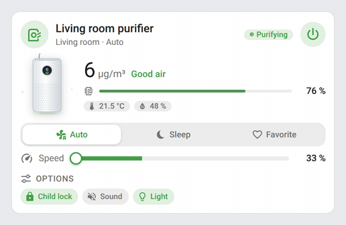 | 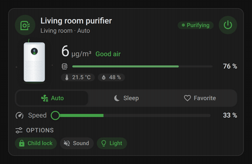 |

A Dyson-style bladeless purifier has no blades to turn: clean air streams up through its hollow loop instead.

| Light | Dark |
|---|---|
| 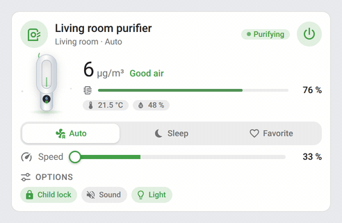 | 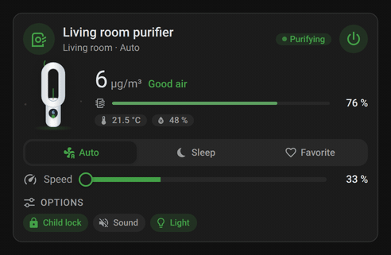 |

The fan spins its blades, the head slowly oscillates from side to side, and gusts of air stream out in front of it.

| Light | Dark |
|---|---|
| 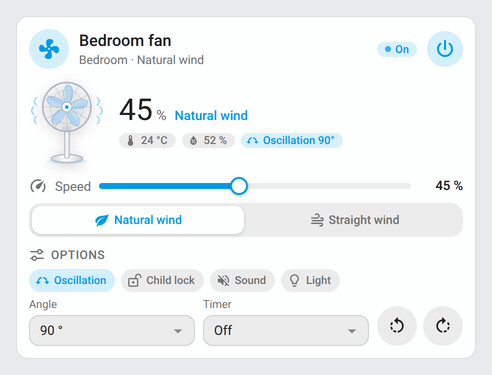 | 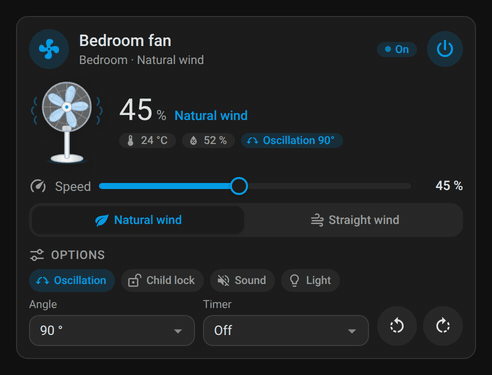 |

The air conditioner swings its louvres while the cooled air falls out of the vent.

| Light | Dark |
|---|---|
| 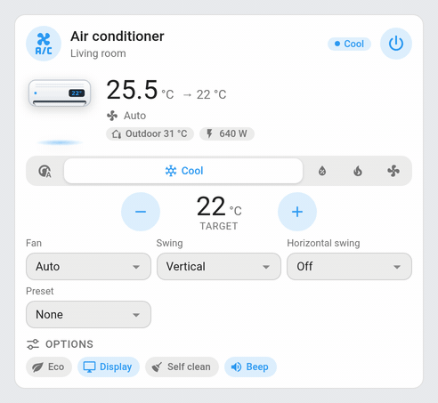 | 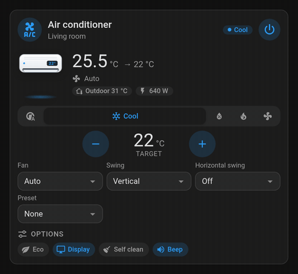 |

Heating, the warm air shimmers as it rises out of the vent.

| Light | Dark |
|---|---|
| 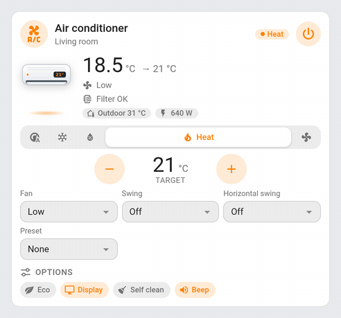 | 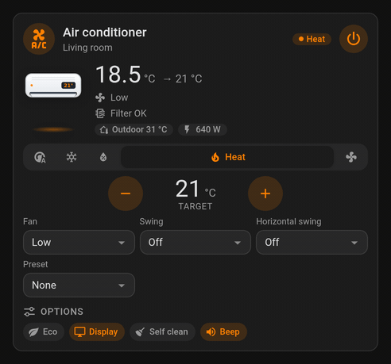 |

Drying, droplets fall from the vent instead.

| Light | Dark |
|---|---|
| 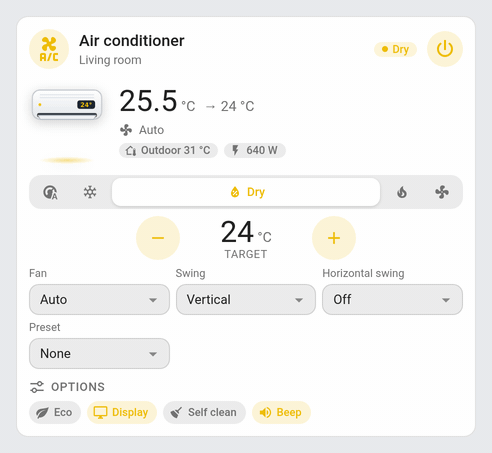 | 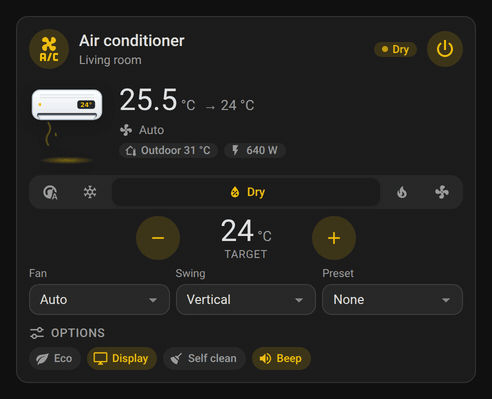 |

The heat pump spins its outdoor fan while the water flows in the pipes and warm air rises above the unit.

| Light | Dark |
|---|---|
| 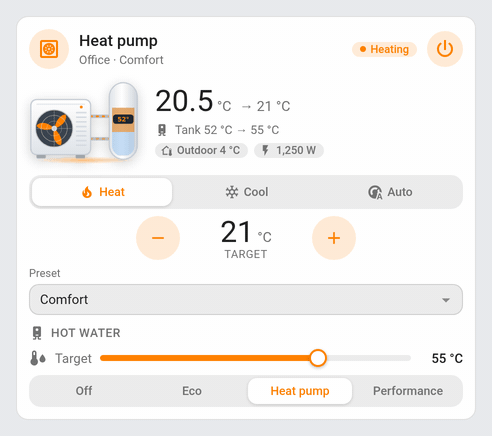 | 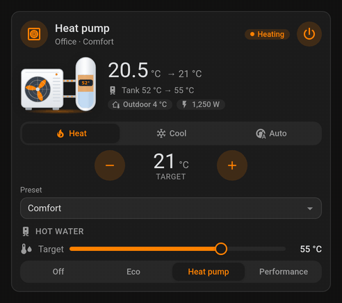 |

Heating the hot water, the valve sends the flow to the tank and heat rises above it.

| Light | Dark |
|---|---|
| 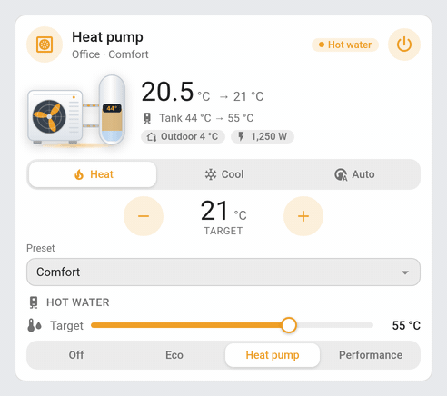 | 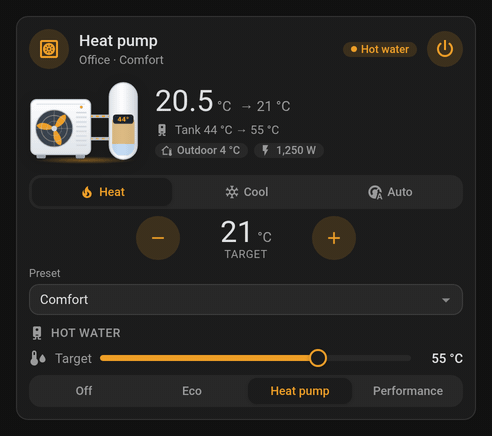 |

Cooling, snowflakes fall above the unit.

| Light | Dark |
|---|---|
| 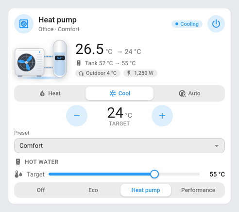 | 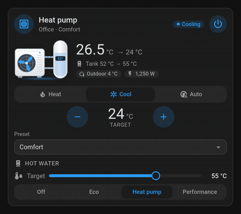 |

The humidifier humidifies: mist rises from its top and the water waves in its tank.

| Light | Dark |
|---|---|
| 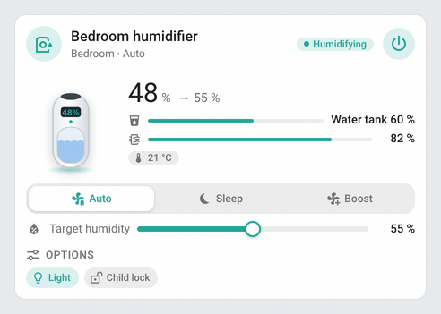 | 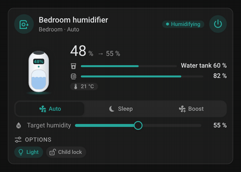 |

The VOCOlinc MistFlow sends mist out of its top, its light ring in the colour of its light.

| Light | Dark |
|---|---|
|  | 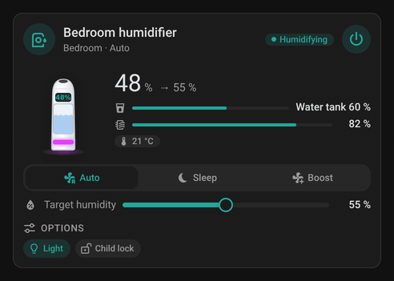 |

The VOCOlinc FlowerBud sends scented mist from its tip, its frosted cone lit in the colour of its mood light (white while the light is off).

| Light | Dark |
|---|---|
| 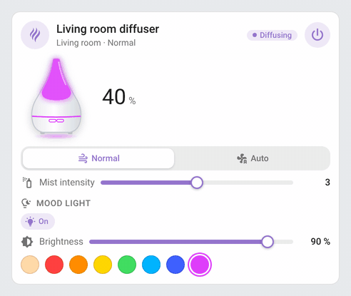 | 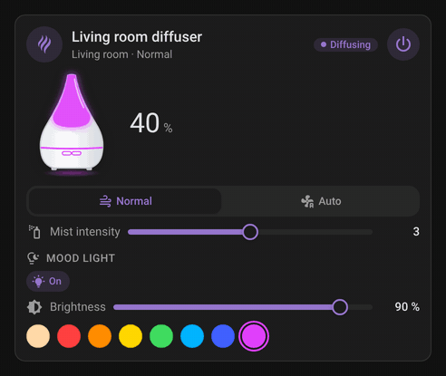 |

The dehumidifier blows dry air out of its top while drops fall into its bucket.

| Light | Dark |
|---|---|
| 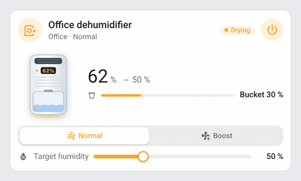 | 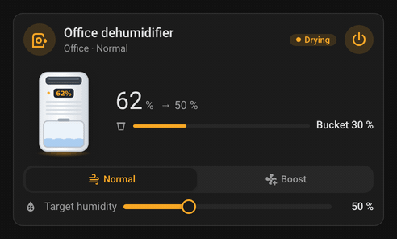 |

The overview gathers every device: each tile's icon moves to match its appliance and its status ring breathes around it.

| Light | Dark |
|---|---|
| 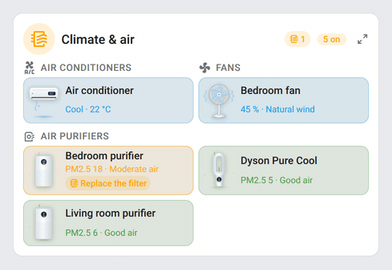 | 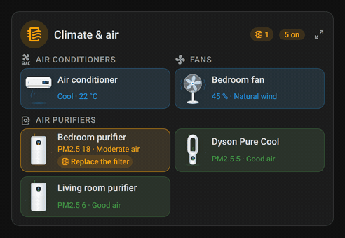 |

| | Light | Dark |
|---|---|---|
| Overview, devices on | 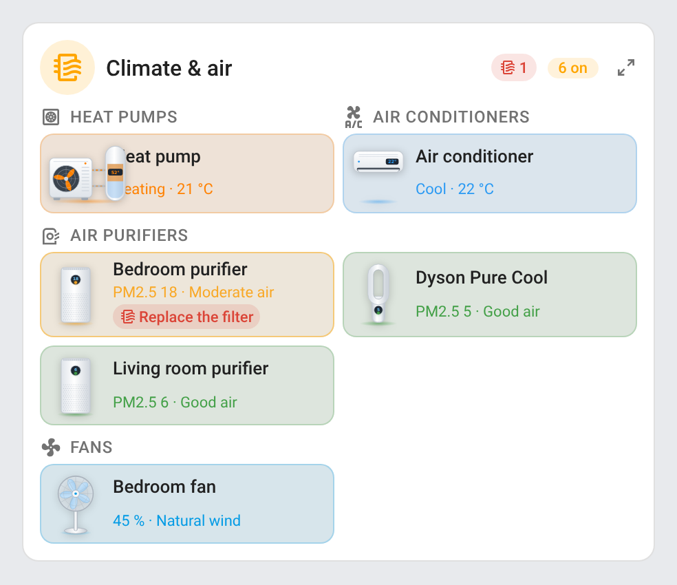 | 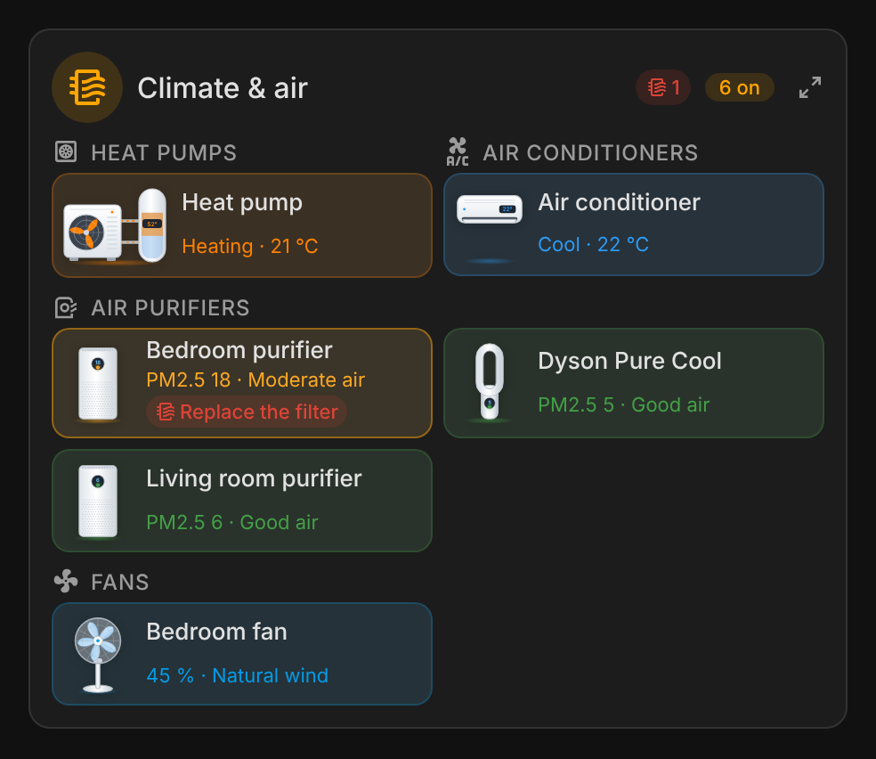 |
| Overview grouped by area, tiles labelled by kind | 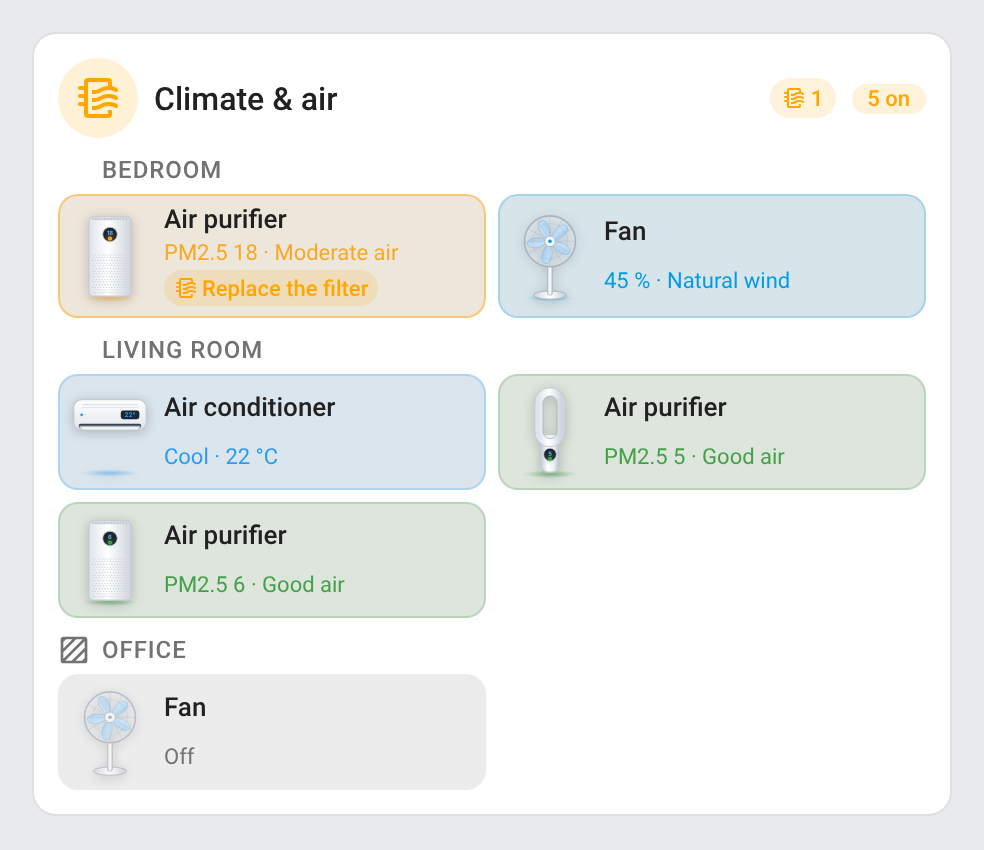 | 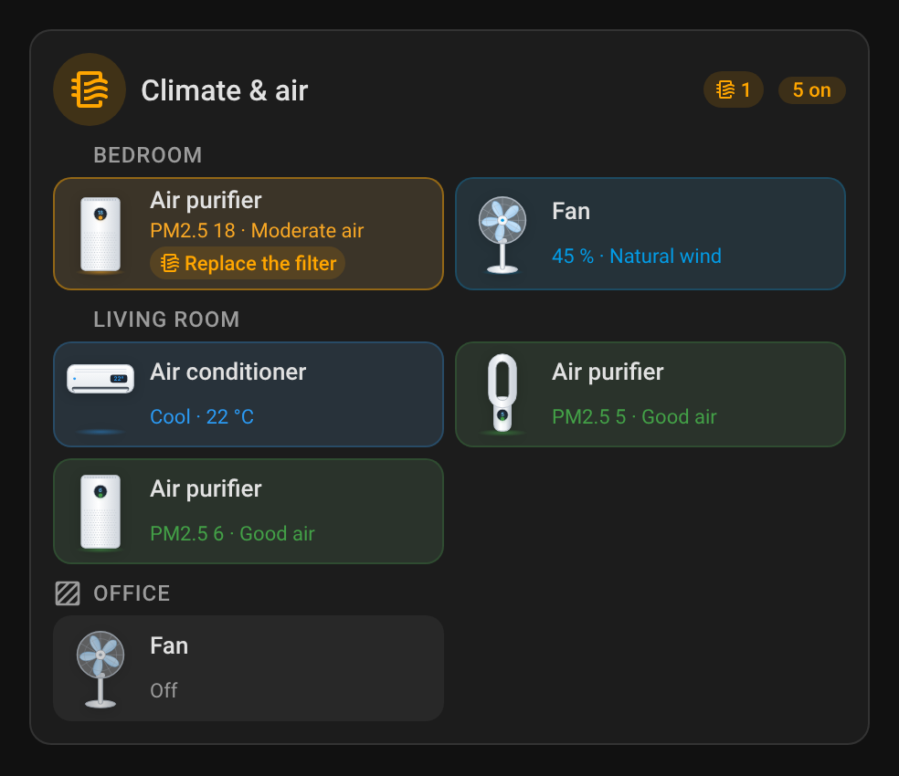 |
| Overview, a device unfolded | 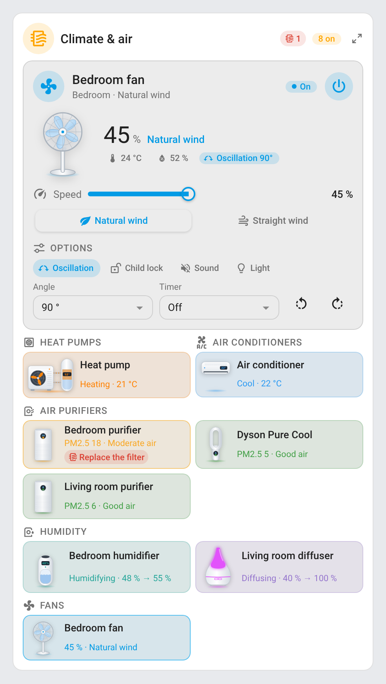 |  |
| Air purifier, filter to replace |  |  |
| Air purifier, round and box |   |   |
| Air purifier, Dyson bladeless |  |  |
| Fan |  |  |
| Air conditioner, heating |  |  |
| Air conditioner, heat / cool range |  |  |
| Air conditioner, drying to a target humidity |  |  |
| Heat pump, cooling |  |  |
| Humidifier, clear tank and evaporative |   |   |
| Diffuser off, its mood light on in blue |  |  |
| Humidifier, water tank empty |  |  |
| Air conditioner, portable and window split |   |   |

## Development

```bash
npm install
npm run build        # bundles src/*.js into dist/ha-climate-air-card.js and stamps the version of package.json
npm run check        # builds and checks the bundle (run in CI)
npm test             # unit tests, no browser
npm run screenshots  # renders every card (and a looping gif per animation: purifier/fan/aircon cool, heat and dry/heat pump heat, hot water and cool/humidifier, MistFlow, diffuser and dehumidifier/overview, needs ffmpeg) with mock data into screenshots/
```

Each card has its own source in `src/`, next to `src/shared.js`; the build wraps each one in its own block and concatenates them into the single file the Marketplace installs. `dist/` is not committed: `npm run build` creates it locally, CI builds it on every push, and the release workflow attaches the built file to the release, which is where the Marketplace installs it from.

### Releasing

1. Bump `version` in `package.json`
2. Add a `## <version>` section at the top of [CHANGELOG.md](https://github.com/juju35/ha-climate-air-card/blob/main/CHANGELOG.md)
3. Push to `main`: the **Release** workflow builds the bundle, creates the tag and the GitHub release with the changelog section as notes, and attaches `ha-climate-air-card.js`

## Translations

The cards auto-detect the language from your Home Assistant settings. Currently supported:

| Language | Code |
|---|---|
| English | `en` |
| Français | `fr` |
| Deutsch | `de` |
| Español | `es` |
| Српски | `sr` |
| Srpski (latinica) | `sr-Latn` |
| Italiano | `it` |
| Nederlands | `nl` |
| Português (Portugal) | `pt` |
| Polski | `pl` |
| Română | `ro` |
| Dansk | `da` |
| Svenska | `sv` |
| Български | `bg` |
| Русский | `ru` |
| Українська | `uk` |
| Magyar | `hu` |
| Slovenčina | `sk` |
| Čeština | `cs` |
| Slovenščina | `sl` |
| Latviešu | `lv` |
| Ελληνικά | `el` |

Contributions for additional languages are welcome!

## License

[MIT](https://github.com/juju35/ha-climate-air-card/blob/main/LICENSE)

## Support

If you find this project useful, you can support its development:

<a href="https://buymeacoffee.com/julienstep9"></a>
